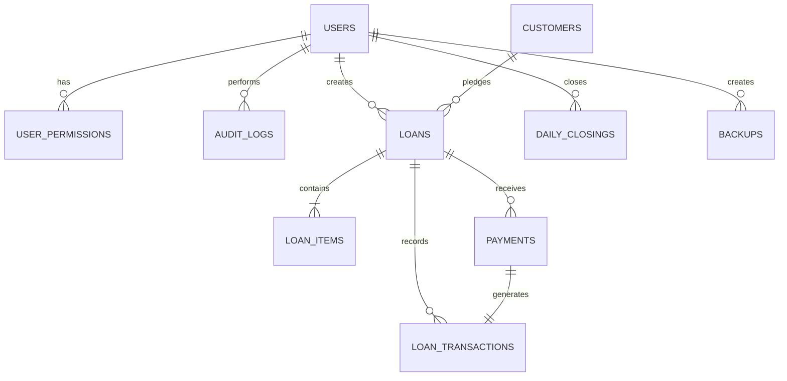

# Database Schema Reference & Entity Relationship

## Overview

The Jewellery Loan Management Application uses an embedded, zero-configuration **SQLite 3** database managed via `better-sqlite3`. The database operates strictly locally with **Write-Ahead Logging (WAL)** and **Foreign Key constraints enforced** on every connection.

### Performance & Durability Flags
```sql
PRAGMA journal_mode = WAL;
PRAGMA synchronous = NORMAL;
PRAGMA foreign_keys = ON;
PRAGMA temp_store = MEMORY;
```

---

## 1. Entity-Relationship Diagram



---

## 2. Financial Precision Principles

1. **Currency in Integer Paise**:
   - All financial amounts (`principal`, `interest`, `fees`, `valuation`, `payments`, `balances`) are stored as **64-bit integer paise** (`INTEGER`).
   - ₹1.00 = 100 paise.
   - Eliminates IEEE 754 floating-point rounding discrepancies.
2. **Weight in Floating/Fixed Milligram Accuracy**:
   - Weights (`gross_weight_grams`, `stone_weight_grams`, `net_weight_grams`) are stored as `REAL` and rounded to 3 decimal places (`0.001g` = 1 milligram accuracy).
3. **Rates in Paise per Gram**:
   - Gold and silver rates are stored as paise per gram (e.g., ₹7,150.00/g = 715,000 paise).

---

## 3. Table Definitions

### 3.1 `users`
System operators with role-based access control (Super Admin / Owner vs. Worker / Executive).

| Column | Type | Constraints | Description |
| :--- | :--- | :--- | :--- |
| `id` | TEXT | PRIMARY KEY | Unique user ID (`USR-uuid`) |
| `username` | TEXT | UNIQUE NOT NULL | Alphanumeric login identifier |
| `password_hash`| TEXT | NOT NULL | PBKDF2-SHA512 derived password hash |
| `password_salt`| TEXT | NOT NULL | Cryptographic random 32-byte hex salt |
| `full_name` | TEXT | NOT NULL | Legal name of employee / owner |
| `role` | TEXT | NOT NULL CHECK (role IN ('OWNER', 'EXECUTIVE')) | Role tier |
| `is_active` | INTEGER | NOT NULL DEFAULT 1 | 1 for active, 0 for deactivated |
| `last_login` | TEXT | NULL | ISO8601 timestamp of previous session |
| `created_at` | TEXT | NOT NULL | Record creation ISO8601 timestamp |
| `updated_at` | TEXT | NOT NULL | Last update ISO8601 timestamp |

---

### 3.2 `user_permissions`
Granular permission overrides for staff executives.

| Column | Type | Constraints | Description |
| :--- | :--- | :--- | :--- |
| `id` | TEXT | PRIMARY KEY | Unique permission record ID |
| `user_id` | TEXT | NOT NULL REFERENCES users(id) ON DELETE CASCADE | Target user |
| `permission_key`| TEXT | NOT NULL | Action key (e.g. `MANAGE_RATES`, `EDIT_LOANS`) |
| `is_granted` | INTEGER | NOT NULL DEFAULT 1 | 1 = enabled, 0 = forbidden |

---

### 3.3 `business_settings`
Single-row configuration storage for shop identity, printing headers, sequence numbering, and loan defaults.

| Column | Type | Constraints | Description |
| :--- | :--- | :--- | :--- |
| `id` | INTEGER | PRIMARY KEY CHECK (id = 1) | Single singleton row constraint |
| `business_name` | TEXT | NOT NULL | Registered firm name |
| `tagline` | TEXT | NULL | Sub-header or slogan |
| `logo_url` | TEXT | NULL | Base64 or local image file path |
| `address` | TEXT | NOT NULL | Shop street address |
| `city` | TEXT | NOT NULL | City |
| `state` | TEXT | NOT NULL | State / Province |
| `pincode` | TEXT | NOT NULL | PIN code |
| `phone` | TEXT | NOT NULL | Business contact telephone |
| `email` | TEXT | NULL | Business email address |
| `gst_number` | TEXT | NULL | GSTIN |
| `registration_number`| TEXT | NULL | Money Lending / Pawn Broker license number |
| `receipt_header` | TEXT | NULL | Custom text on top of vouchers |
| `receipt_footer` | TEXT | NULL | Legal notes & disclaimers |
| `terms_conditions`| TEXT | NULL | Standard pledge contract terms |
| `default_interest_rate_percent` | REAL | NOT NULL DEFAULT 2.0 | Monthly interest rate % |
| `default_interest_method` | TEXT | NOT NULL DEFAULT 'MONTHLY_SIMPLE' | Accrual mode |
| `default_interest_period` | TEXT | NOT NULL DEFAULT 'MONTHLY' | Unit period |
| `default_ltv_percent` | REAL | NOT NULL DEFAULT 75.0 | Max allowable Loan-To-Value ceiling |
| `default_min_interest_days` | INTEGER | NOT NULL DEFAULT 15 | Minimum interest lock days |
| `default_grace_period_days` | INTEGER | NOT NULL DEFAULT 7 | Overdue grace days |
| `loan_prefix` | TEXT | NOT NULL DEFAULT 'LN' | Prefix for loan IDs (`LN-YYYY-NNNNNN`) |
| `customer_prefix` | TEXT | NOT NULL DEFAULT 'CUST' | Prefix for customer IDs (`CUST-NNNNNN`) |
| `receipt_prefix` | TEXT | NOT NULL DEFAULT 'RCP' | Prefix for vouchers (`RCP-YYYY-NNNNNN`) |
| `auto_backup_enabled` | INTEGER | NOT NULL DEFAULT 1 | Periodic backup toggle |
| `backup_folder_path` | TEXT | NULL | Custom directory for backup dumps |
| `inactivity_timeout_minutes` | INTEGER | NOT NULL DEFAULT 15 | Auto-lock duration |

---

### 3.4 `metal_rates`
Market rate history per metal commodity and caratage.

| Column | Type | Constraints | Description |
| :--- | :--- | :--- | :--- |
| `id` | TEXT | PRIMARY KEY | Rate entry ID |
| `material` | TEXT | NOT NULL CHECK (material IN ('GOLD', 'SILVER', 'OTHER')) | Metal category |
| `purity` | TEXT | NOT NULL | Karatage / Fineness (`24K`, `22K`, `18K`, `999`, `925`) |
| `rate_per_gram_paise` | INTEGER | NOT NULL | Rate in paise per gram |
| `effective_date` | TEXT | NOT NULL | Applicable date (`YYYY-MM-DD`) |
| `updated_by` | TEXT | NOT NULL | Username who adjusted rate |
| `created_at` | TEXT | NOT NULL | Entry timestamp |

---

### 3.5 `customers`
Customer master records with AES-256-GCM encrypted Aadhaar numbers.

| Column | Type | Constraints | Description |
| :--- | :--- | :--- | :--- |
| `id` | TEXT | PRIMARY KEY | Unique ID (`CUST-000001`) |
| `full_name` | TEXT | NOT NULL | Full legal customer name |
| `phone` | TEXT | NOT NULL | 10-digit mobile number |
| `alternate_phone` | TEXT | NULL | Secondary phone or emergency contact |
| `aadhaar_last4` | TEXT | NOT NULL | Plaintext last 4 digits for fast indexing & UI |
| `aadhaar_encrypted`| TEXT | NOT NULL | AES-256-GCM encrypted ciphertext |
| `aadhaar_iv` | TEXT | NOT NULL | 12-byte initialization vector (hex) |
| `aadhaar_tag` | TEXT | NOT NULL | 16-byte authentication tag (hex) |
| `address` | TEXT | NOT NULL | Residence street address |
| `city` | TEXT | NOT NULL | City |
| `state` | TEXT | NOT NULL | State |
| `pincode` | TEXT | NOT NULL | PIN code |
| `photo_path` | TEXT | NULL | Offline avatar / customer snapshot path |
| `remarks` | TEXT | NULL | Notes / reputation remarks |
| `is_deleted` | INTEGER | NOT NULL DEFAULT 0 | Soft-deletion flag |
| `created_by` | TEXT | NOT NULL | Operator username |
| `created_at` | TEXT | NOT NULL | Registration timestamp |
| `updated_at` | TEXT | NOT NULL | Modification timestamp |

---

### 3.6 `loans`
Principal loan contracts against jewellery collateral.

| Column | Type | Constraints | Description |
| :--- | :--- | :--- | :--- |
| `id` | TEXT | PRIMARY KEY | Formatted loan number (`LN-2026-000001`) |
| `customer_id` | TEXT | NOT NULL REFERENCES customers(id) | Debtor customer |
| `loan_date` | TEXT | NOT NULL | Disbursement date (`YYYY-MM-DD`) |
| `start_date` | TEXT | NOT NULL | Interest calculation accrual start date |
| `due_date` | TEXT | NOT NULL | Loan maturity date |
| `principal_paise` | INTEGER | NOT NULL | Initial principal disbursed in paise |
| `interest_rate_percent` | REAL | NOT NULL | Interest rate percentage |
| `interest_period` | TEXT | NOT NULL DEFAULT 'MONTHLY' | Rate tenure (`MONTHLY`, `YEARLY`, `DAILY`) |
| `interest_method` | TEXT | NOT NULL DEFAULT 'MONTHLY_SIMPLE' | Accrual model |
| `min_interest_days` | INTEGER | NOT NULL DEFAULT 15 | Minimum interest lock days |
| `grace_period_days` | INTEGER | NOT NULL DEFAULT 7 | Overdue threshold grace period |
| `processing_fee_paise` | INTEGER | NOT NULL DEFAULT 0 | Upfront processing charge |
| `other_charges_paise` | INTEGER | NOT NULL DEFAULT 0 | Documentation / stamp charges |
| `principal_outstanding_paise` | INTEGER | NOT NULL | Current unpaid principal in paise |
| `interest_outstanding_paise` | INTEGER | NOT NULL DEFAULT 0 | Accumulated unpaid interest in paise |
| `status` | TEXT | NOT NULL CHECK (status IN ('DRAFT', 'ACTIVE', 'PARTIALLY_PAID', 'OVERDUE', 'CLOSED', 'CANCELLED')) | Operational loan lifecycle status |
| `ltv_percent` | REAL | NOT NULL | LTV percentage applied |
| `total_valuation_paise` | INTEGER | NOT NULL | Appraised value of pledged jewellery |
| `is_override` | INTEGER | NOT NULL DEFAULT 0 | Flag if executive/owner overrode LTV |
| `override_reason` | TEXT | NULL | Mandatory explanation if LTV overridden |
| `remarks` | TEXT | NULL | Internal officer notes |
| `created_by` | TEXT | NOT NULL | Loan creator username |
| `created_at` | TEXT | NOT NULL | Booking timestamp |
| `closed_at` | TEXT | NULL | Final settlement timestamp |
| `closed_by` | TEXT | NULL | Settling operator username |

---

### 3.7 `loan_items`
Individual jewellery items pledged in vault custody under a loan.

| Column | Type | Constraints | Description |
| :--- | :--- | :--- | :--- |
| `id` | TEXT | PRIMARY KEY | Unique item token |
| `loan_id` | TEXT | NOT NULL REFERENCES loans(id) ON DELETE CASCADE | Associated loan |
| `category` | TEXT | NOT NULL | Item category (`Necklace`, `Bangles`, `Ring`, etc.) |
| `description` | TEXT | NOT NULL | Visual design and hallmark description |
| `material` | TEXT | NOT NULL CHECK (material IN ('GOLD', 'SILVER', 'OTHER')) | Precious metal |
| `purity` | TEXT | NOT NULL | Karat / Fineness (`22K`, `999`, etc.) |
| `gross_weight_grams`| REAL | NOT NULL | Scale weight with stones |
| `stone_weight_grams`| REAL | NOT NULL DEFAULT 0.0 | Tare weight for non-metal beads/wax/stones |
| `net_weight_grams` | REAL | NOT NULL | Pure precious metal weight (`Gross - Stone`) |
| `rate_per_gram_paise`| INTEGER | NOT NULL | Valuation metal rate at booking |
| `valuation_paise` | INTEGER | NOT NULL | `Net Weight * Rate` |
| `max_loan_paise` | INTEGER | NOT NULL | `Valuation * LTV%` |
| `allocated_loan_paise`| INTEGER | NOT NULL | Allocated portion of loan principal |
| `photo_path` | TEXT | NULL | Local vault image capture path |
| `condition` | TEXT | NOT NULL DEFAULT 'GOOD' CHECK (condition IN ('EXCELLENT', 'GOOD', 'FAIR', 'SCRAP')) | Physical condition |
| `status` | TEXT | NOT NULL DEFAULT 'PLEDGED' CHECK (status IN ('PLEDGED', 'RELEASED', 'UNDER_DISPUTE', 'SEIZED')) | Custody state |
| `remarks` | TEXT | NULL | Damage or stone details |
| `created_at` | TEXT | NOT NULL | Record creation timestamp |

---

### 3.8 `payments`
Receipted incoming cash/digital payment transactions from borrowers.

| Column | Type | Constraints | Description |
| :--- | :--- | :--- | :--- |
| `id` | TEXT | PRIMARY KEY | Payment token |
| `loan_id` | TEXT | NOT NULL REFERENCES loans(id) | Associated loan |
| `receipt_no` | TEXT | UNIQUE NOT NULL | Voucher sequence (`RCP-2026-000001`) |
| `payment_date` | TEXT | NOT NULL | Date payment received (`YYYY-MM-DD`) |
| `total_amount_paise` | INTEGER | NOT NULL | Total funds received in paise |
| `interest_paid_paise`| INTEGER | NOT NULL DEFAULT 0 | Funds applied to interest debt |
| `fees_paid_paise` | INTEGER | NOT NULL DEFAULT 0 | Funds applied to charges / fees |
| `principal_paid_paise`| INTEGER | NOT NULL DEFAULT 0 | Funds applied to reduce principal balance |
| `payment_mode` | TEXT | NOT NULL CHECK (payment_mode IN ('CASH', 'UPI', 'BANK_TRANSFER', 'CHEQUE', 'OTHER')) | Payment channel |
| `reference_no` | TEXT | NULL | UTR / Cheque / Transaction ref number |
| `remarks` | TEXT | NULL | Settlement notes |
| `created_by` | TEXT | NOT NULL | Cashier username |
| `created_at` | TEXT | NOT NULL | Entry timestamp |

---

### 3.9 `loan_transactions`
Double-entry immutable financial ledger tracking all debits and credits on loan accounts.

| Column | Type | Constraints | Description |
| :--- | :--- | :--- | :--- |
| `id` | TEXT | PRIMARY KEY | Transaction ledger ID |
| `loan_id` | TEXT | NOT NULL REFERENCES loans(id) | Target loan |
| `transaction_date` | TEXT | NOT NULL | Posting timestamp |
| `type` | TEXT | NOT NULL CHECK (type IN ('DISBURSEMENT', 'INTEREST_ACCRUAL', 'REPAYMENT', 'FEE_CHARGE', 'PENALTY', 'REVERSAL', 'ADJUSTMENT', 'CLOSURE')) | Transaction classification |
| `debit_paise` | INTEGER | NOT NULL DEFAULT 0 | Debit amount in paise |
| `credit_paise` | INTEGER | NOT NULL DEFAULT 0 | Credit amount in paise |
| `principal_balance_paise`| INTEGER | NOT NULL | Running principal balance post-transaction |
| `interest_balance_paise`| INTEGER | NOT NULL | Running accrued interest balance post-transaction |
| `payment_mode` | TEXT | NULL | Mode for cash/digital transactions |
| `reference_no` | TEXT | NULL | Receipt or payment reference |
| `description` | TEXT | NOT NULL | Explanatory narrative |
| `created_by` | TEXT | NOT NULL | Author username |
| `is_reversal` | INTEGER | NOT NULL DEFAULT 0 | Flag indicating reversal compensating entry |
| `reversed_transaction_id`| TEXT | NULL | Pointer to original transaction reversed |
| `created_at` | TEXT | NOT NULL | Record insertion timestamp |

---

### 3.10 `daily_closings`
End-of-day register tallies for cash drawer and digital payment reconciliation.

| Column | Type | Constraints | Description |
| :--- | :--- | :--- | :--- |
| `id` | TEXT | PRIMARY KEY | Closing ID (`EOD-YYYY-MM-DD`) |
| `closing_date` | TEXT | UNIQUE NOT NULL | Calendar date (`YYYY-MM-DD`) |
| `total_disbursed_paise`| INTEGER | NOT NULL DEFAULT 0 | Total new loans disbursed during day |
| `total_collected_paise`| INTEGER | NOT NULL DEFAULT 0 | Total collections received during day |
| `cash_collected_paise` | INTEGER | NOT NULL DEFAULT 0 | Cash drawer receipts |
| `upi_collected_paise` | INTEGER | NOT NULL DEFAULT 0 | UPI digital receipts |
| `bank_collected_paise` | INTEGER | NOT NULL DEFAULT 0 | Direct bank transfers |
| `cheque_collected_paise`| INTEGER | NOT NULL DEFAULT 0 | Cheques / drafts received |
| `total_loans_opened` | INTEGER | NOT NULL DEFAULT 0 | Count of new loans opened |
| `total_loans_closed` | INTEGER | NOT NULL DEFAULT 0 | Count of loans settled & closed |
| `net_cash_flow_paise` | INTEGER | NOT NULL DEFAULT 0 | `Total Collected - Total Disbursed` |
| `closed_by` | TEXT | NOT NULL | Owner / Manager username |
| `closed_at` | TEXT | NOT NULL | Finalization timestamp |

---

### 3.11 `audit_logs`
Cryptographically traceable, append-only security log of all sensitive user activities.

| Column | Type | Constraints | Description |
| :--- | :--- | :--- | :--- |
| `id` | TEXT | PRIMARY KEY | Log token |
| `timestamp` | TEXT | NOT NULL | Activity timestamp |
| `user_id` | TEXT | NOT NULL | Operator user ID |
| `username` | TEXT | NOT NULL | Operator username |
| `action` | TEXT | NOT NULL | Action verb (`LOGIN`, `CREATE_LOAN`, `REPAYMENT`, `UNMASK_AADHAAR`, `RESTORE_DATABASE`, etc.) |
| `module` | TEXT | NOT NULL | Subsystem (`AUTH`, `LOAN`, `CUSTOMER`, `PAYMENT`, `BACKUP`, etc.) |
| `record_id` | TEXT | NULL | Key of modified domain entity |
| `previous_value` | TEXT | NULL | JSON snapshot of previous state |
| `new_value` | TEXT | NULL | JSON snapshot of updated state |
| `reason` | TEXT | NULL | Justification for sensitive adjustments |

---

### 3.12 `backups`
Metadata registry of automated and manual database backups.

| Column | Type | Constraints | Description |
| :--- | :--- | :--- | :--- |
| `id` | TEXT | PRIMARY KEY | Backup record ID |
| `backup_path` | TEXT | NOT NULL | Absolute local file system location |
| `backup_type` | TEXT | NOT NULL CHECK (backup_type IN ('MANUAL', 'AUTOMATIC', 'PRE_RESTORE')) | Backup origin |
| `file_size_bytes` | INTEGER | NOT NULL | Snapshot file size |
| `status` | TEXT | NOT NULL DEFAULT 'SUCCESS' | Status (`SUCCESS` or `FAILED`) |
| `created_by` | TEXT | NOT NULL | Operator or system |
| `created_at` | TEXT | NOT NULL | Timestamp |

---

## 4. Query Optimization & Indexes

The following indexes maintain sub-millisecond retrieval across large loan catalogs:

```sql
-- Customer Indexes
CREATE INDEX IF NOT EXISTS idx_customers_phone ON customers(phone);
CREATE INDEX IF NOT EXISTS idx_customers_full_name ON customers(full_name);
CREATE INDEX IF NOT EXISTS idx_customers_aadhaar_last4 ON customers(aadhaar_last4);
CREATE INDEX IF NOT EXISTS idx_customers_is_deleted ON customers(is_deleted);

-- Loan Indexes
CREATE INDEX IF NOT EXISTS idx_loans_customer_id ON loans(customer_id);
CREATE INDEX IF NOT EXISTS idx_loans_status ON loans(status);
CREATE INDEX IF NOT EXISTS idx_loans_due_date ON loans(due_date);
CREATE INDEX IF NOT EXISTS idx_loans_loan_date ON loans(loan_date);
CREATE INDEX IF NOT EXISTS idx_loans_active_due ON loans(status, due_date);

-- Collateral Items Indexes
CREATE INDEX IF NOT EXISTS idx_loan_items_loan_id ON loan_items(loan_id);
CREATE INDEX IF NOT EXISTS idx_loan_items_status ON loan_items(status);
CREATE INDEX IF NOT EXISTS idx_loan_items_material_purity ON loan_items(material, purity);

-- Payment Indexes
CREATE INDEX IF NOT EXISTS idx_payments_loan_id ON payments(loan_id);
CREATE INDEX IF NOT EXISTS idx_payments_date ON payments(payment_date);
CREATE INDEX IF NOT EXISTS idx_payments_receipt_no ON payments(receipt_no);

-- Ledger Indexes
CREATE INDEX IF NOT EXISTS idx_loan_transactions_loan_id ON loan_transactions(loan_id);
CREATE INDEX IF NOT EXISTS idx_loan_transactions_date ON loan_transactions(transaction_date);

-- Audit & Rates Indexes
CREATE INDEX IF NOT EXISTS idx_audit_logs_timestamp ON audit_logs(timestamp);
CREATE INDEX IF NOT EXISTS idx_audit_logs_user_id ON audit_logs(user_id);
CREATE INDEX IF NOT EXISTS idx_audit_logs_module ON audit_logs(module);
CREATE INDEX IF NOT EXISTS idx_metal_rates_effective ON metal_rates(material, purity, effective_date);
```
