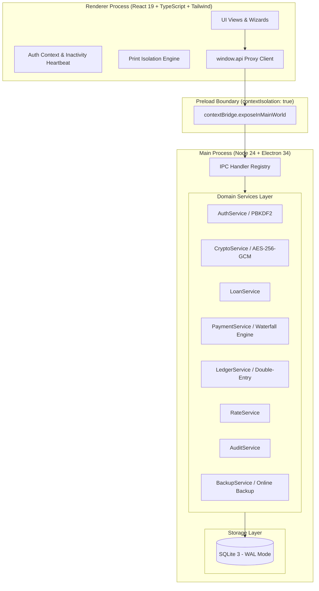

# Developer Architecture & Technical Reference Guide

## 1. System Architecture Overview

The Jewellery Loan Management Application is built as a **100% offline desktop application** for pawn brokers and jewellery lending businesses. It runs on **Electron 34**, with **React 19** and **Tailwind CSS** in the renderer, and **better-sqlite3** in the Node.js main process.



---

## 2. Process Isolation & Security Architecture

### 2.1 Context Isolation & Sandboxing
The Electron window is configured with maximum hardening flags in `electron/main.ts`:
- `contextIsolation: true`
- `nodeIntegration: false`
- `webSecurity: true`
- `allowRunningInsecureContent: false`

The renderer process never accesses `fs`, `crypto`, or `better-sqlite3` directly. All operations pass across typed IPC channels exposed in `electron/preload.ts`.

### 2.2 Offline Enforcement
The application makes **zero network requests**:
- No external CDNs, fonts, or tracking scripts. All Tailwind styles, SVG icons (`lucide-react`), and fonts are bundled locally.
- WebContents navigation is strictly intercepted and blocked (`will-navigate` blocks all external URLs).

### 2.3 Cryptography & Sensitive Data Protection
All cryptographic functions are centralized in `electron/services/cryptoService.ts`:
- **Password Hashing**: Salted PBKDF2 using `sha512`, 100,000 iterations, with a cryptographically secure 32-byte salt generated via `crypto.randomBytes(32)`.
- **Timing-Safe Verification**: Passwords are verified using `crypto.timingSafeEqual` with strict buffer length guards to eliminate timing side-channel attacks.
- **Aadhaar Encryption at Rest**: Customer Aadhaar numbers are encrypted using **AES-256-GCM** with a unique 12-byte initialization vector (`iv`) per row. Both the ciphertext, IV, and 16-byte GCM authentication tag are stored in the database.
- **Default Masking**: In all general UI views and executive workflows, only the last 4 digits are exposed (`XXXX XXXX 1234`). Only users with the `OWNER` role can invoke `getUnmaskedAadhaar()`, which triggers an immutable audit log.

---

## 3. Financial Computation Engine

### 3.1 Integer Paise Rule (`₹1 = 100 paise`)
All monetary calculations and storage use integer paise to avoid IEEE 754 floating-point errors.
Helper functions in `src/utils/currency.ts` convert and format currency:
```typescript
export const rupeesToPaise = (rupees: number): number => Math.round(rupees * 100);
export const paiseToRupees = (paise: number): number => paise / 100;
export const formatINR = (paise: number): string => ... // "₹1,25,000.00"
```

### 3.2 Valuation & LTV Algorithm
Implemented in `electron/services/valuationService.ts`:
1. **Net Weight**:
   $$\text{Net Weight (g)} = \text{Gross Weight (g)} - \text{Stone/Wax Weight (g)}$$
2. **Item Valuation**:
   $$\text{Valuation (paise)} = \text{Net Weight (g)} \times \text{Rate per Gram (paise)}$$
3. **Eligible Loan Ceiling**:
   $$\text{Max Loan (paise)} = \text{Valuation (paise)} \times \left(\frac{\text{LTV}\%}{100}\right)$$

### 3.3 Repayment Waterfall Engine
Implemented in `electron/services/paymentService.ts`:
When a repayment is made, incoming funds are strictly allocated in priority order:
1. **Accrued Interest**: All unpaid accrued interest is satisfied first.
2. **Outstanding Fees / Charges**: Processing fees or penalties are satisfied next.
3. **Principal Reduction**: Any remainder directly reduces the outstanding principal balance.

```typescript
// Waterfall Algorithm in PaymentService.ts
const interestPaid = Math.min(amountPaise, accruedInterestPaise);
const remainingAfterInterest = amountPaise - interestPaid;

const feesPaid = Math.min(remainingAfterInterest, loan.other_charges_paise);
const remainingAfterFees = remainingAfterInterest - feesPaid;

const principalPaid = Math.min(remainingAfterFees, loan.principal_outstanding_paise);
```

### 3.4 Accrual Date Advancing & Partial Payments
When a partial repayment occurs:
- If all accrued interest is satisfied, the loan's `start_date` is updated to the `payment_date`, and any remainder pays down principal.
- If the payment was less than the accrued interest, the unpaid portion of interest is retained in `loan.interest_outstanding_paise`, and the accrual start date advances to ensure interest does not double-compound.

---

## 4. Double-Entry Running Ledger & Immutability

### 4.1 Ledger Engine (`electron/services/ledgerService.ts`)
Every financial movement on a loan writes an immutable entry into `loan_transactions`:
- **Debit (Dr)**: Disbursements, Interest Accruals, Penalty/Fee charges.
- **Credit (Cr)**: Repayments.
- Each record maintains the running post-transaction balances:
  - `principal_balance_paise`
  - `interest_balance_paise`

### 4.2 Reversal Accounting
Transactions are **never deleted or modified**. If an executive makes an erroneous entry:
1. A compensating reversal transaction is created (`is_reversal = 1`).
2. The reversal references the original transaction ID (`reversed_transaction_id`).
3. The running balances are adjusted accordingly with an audit trail.

---

## 5. Automated Backup & Disaster Recovery

### 5.1 Online Hot Backup
Implemented in `electron/services/backupService.ts`:
- Uses better-sqlite3's native `db.backup(destPath)` API to snapshot the active database without stopping readers or writers in WAL mode.
- Before every backup, runs `PRAGMA integrity_check` to guarantee the snapshot is not corrupted.

### 5.2 Pre-Restore Safety Checkpoint
When restoring a database from an archive file:
1. Verifies the chosen backup file via `PRAGMA integrity_check`.
2. Creates an automatic safety backup of the currently running database (`PRE_RESTORE`).
3. Closes database handles and removes leftover `-wal` and `-shm` index files.
4. Atomically replaces the database file and reinitializes connections.

---

## 6. Directory Layout

```
Jewelery/
├── electron/
│   ├── main.ts                   # Electron main window lifecycle & IPC registration
│   ├── preload.ts                # Context bridge API exposure
│   ├── types.ts                  # Shared domain types for Node/Electron process
│   ├── database/
│   │   ├── connection.ts         # SQLite instance, WAL config, path resolution
│   │   ├── schema.ts             # DDL statements and migration indexes
│   │   └── seed.ts               # Demo data seeder for local development
│   └── services/
│       ├── authService.ts        # User sessions & RBAC
│       ├── auditService.ts       # Immutable audit logging
│       ├── backupService.ts      # Hot backups & restore integrity checks
│       ├── cryptoService.ts      # PBKDF2 & AES-256-GCM
│       ├── customerService.ts    # Customer profiles & Aadhaar masking
│       ├── dailyClosingService.ts# Register tallies & cash reconciliation
│       ├── interestService.ts    # Interest accrual formulas
│       ├── ledgerService.ts      # Double-entry ledger & reversals
│       ├── loanService.ts        # Loan contracts & collateral items
│       ├── paymentService.ts     # Repayment waterfall engine
│       ├── rateService.ts        # Metal commodity market rates
│       ├── reportService.ts      # Analytics & CSV export generators
│       └── settingService.ts     # Business profile & loan defaults
├── src/
│   ├── main.tsx                  # React DOM root entry
│   ├── App.tsx                   # Top-level navigation & tab router
│   ├── api.ts                    # Typed wrapper around window.api
│   ├── types/                    # Frontend domain interfaces
│   ├── context/                  # React AuthContext with auto-lock timer
│   ├── utils/                    # Currency (paise/rupees), dates, text formatters
│   ├── components/               # Common UI widgets, modal dialogs, print previews
│   └── views/                    # 17 full-screen operational views
├── tests/                        # Vitest automated test suites
├── DATABASE_SCHEMA.md            # Schema reference & ER diagram
├── DEVELOPER_GUIDE.md            # This architecture guide
├── USER_MANUAL.md                # Operator guide for shop staff
└── README.md                     # Quickstart & build commands
```

---

## 7. Developer Commands & Build Workflows

### Install Dependencies
```bash
npm install
```

### Run Tests
```bash
npm test
```

### Development Server
```bash
# Terminal 1: Vite React dev server
npm run dev

# Terminal 2: Electron main runner
npm run dev:electron
```

### Production Build
```bash
npm run build
```
This performs:
1. `build:renderer`: `tsc -b` (strict TypeScript check) + `vite build` (bundles into `dist/`)
2. `build:electron`: `tsc -p tsconfig.electron.json` (bundles into `dist-electron/`)

### Package Windows Desktop Installer
```bash
npm run dist:dir     # Unpacked Windows portable executable in release/
npm run dist         # Full Windows installer (.exe)
```
