# APIs, Inter-Process Communication (IPC), & Integration Reference — SwarnaRaksha Loan Manager

**Document Version:** 1.0.0  
**Interface Paradigm:** Electron Asynchronous IPC (`ipcRenderer.invoke` $\longleftrightarrow$ `ipcMain.handle`)  
**Network Architecture:** 100% Air-Gapped / Zero External Cloud APIs  
**Source Evidence Files:** `electron/preload.ts`, `electron/main.ts`, `src/api.ts`  

---

## 1. Architectural Interface Overview

SwarnaRaksha is an **offline desktop application** running within an Electron container. It **does not expose any public or internal HTTP/REST endpoints**, nor does it run a local web server (such as Express or Fastify). 

All communication between the user interface (the sandboxed Chromium Renderer Process) and the business logic/database (the privileged Node.js Main Process) is conducted strictly through **Electron Inter-Process Communication (IPC)** over pre-defined channels.

```mermaid
flowchart LR
    subgraph Renderer ["Sandboxed Renderer Process"]
        UIComp["React 19 Components"]
        APIBridge["src/api.ts (window.api)"]
    end

    subgraph Preload ["Preload Boundary (preload.ts)"]
        ContextBridge["contextBridge.exposeInMainWorld('api', ...)"]
    end

    subgraph IPC_Link ["IPC Protocol"]
        IPCSend["ipcRenderer.invoke(channel, ...args)"]
        IPCRecv["ipcMain.handle(channel, handler)"]
    end

    subgraph Main ["Electron Main Process"]
        MainHandlers["electron/main.ts Handlers"]
        DomainServices["Application Domain Services"]
        LocalSQLite[("better-sqlite3 Database")]
    end

    UIComp --> APIBridge
    APIBridge --> ContextBridge
    ContextBridge --> IPCSend
    IPCSend ====>|Message Port IPC| IPCRecv
    IPCRecv --> MainHandlers
    MainHandlers --> DomainServices
    DomainServices --> LocalSQLite
```

---

## 2. Complete Electron IPC Channel Inventory

The application defines **54 distinct IPC channels** across 17 functional modules.

### 2.1 Authentication & User Session (`auth:*`)

| Channel Name | Direction | Handler Location | Parameters | Return Type | Permission Required | Security & Audit Notes |
| :--- | :--- | :--- | :--- | :--- | :--- | :--- |
| `auth:hasAnyUsers` | Render $\to$ Main | `main.ts:88` | None | `boolean` | Unrestricted | Used during initial boot to determine if Setup Wizard is needed. |
| `auth:createFirstOwner` | Render $\to$ Main | `main.ts:89` | `{ username, password, full_name }` | `User` | Unrestricted (One-time) | Blocked if any user exists in `users` table. Hashes password via PBKDF2. |
| `auth:login` | Render $\to$ Main | `main.ts:90` | `username: string, password: string` | `User` | Unrestricted | Timing-safe password verification. Sets session context; logs `LOGIN_SUCCESS` / `LOGIN_FAILED`. |
| `auth:logout` | Render $\to$ Main | `main.ts:91` | None | `void` | Authenticated | Clears active session user; logs `LOGOUT`. |
| `auth:getCurrentUser` | Render $\to$ Main | `main.ts:92` | None | `User \| null` | Authenticated | Returns currently active user in main process. |
| `auth:touchActivity` | Render $\to$ Main | `main.ts:93` | None | `void` | Authenticated | Resets inactivity watchdog timer. |
| `auth:createUser` | Render $\to$ Main | `main.ts:94-97` | `{ username, password, full_name, role, permissions? }` | `User` | `MANAGE_USERS` (Owner) | Generates `USR-id`, hashes password, logs `CREATE_USER`. |
| `auth:listUsers` | Render $\to$ Main | `main.ts:98` | None | `User[]` | `MANAGE_USERS` (Owner) | Returns all user records excluding password hashes. |
| `auth:toggleUserStatus` | Render $\to$ Main | `main.ts:99-102` | `targetUserId: string, isActive: boolean` | `void` | `MANAGE_USERS` (Owner) | Cannot disable primary Owner. Logs `ENABLE_USER`/`DISABLE_USER`. |
| `auth:resetPassword` | Render $\to$ Main | `main.ts:103-106`| `targetUserId: string, newPassword: string` | `void` | `MANAGE_USERS` (Owner) | Re-hashes password with fresh salt; logs `RESET_PASSWORD`. |
| `auth:setUserPermission` | Render $\to$ Main | `main.ts:107-114`| `targetUserId: string, permission: string, isGranted: boolean` | `boolean` | `OWNER` only | Enforces strict role check; updates `user_permissions` table. |

---

### 2.2 Customer Master Operations (`customers:*`)

| Channel Name | Direction | Handler Location | Parameters | Return Type | Permission Required | Security & Audit Notes |
| :--- | :--- | :--- | :--- | :--- | :--- | :--- |
| `customers:createCustomer` | Render $\to$ Main | `main.ts:117-120` | `data: CreateCustomerInput` | `Customer` | `MANAGE_CUSTOMERS` | Encrypts full Aadhaar using AES-256-GCM; stores plaintext `aadhaar_last4`. |
| `customers:updateCustomer` | Render $\to$ Main | `main.ts:121-124` | `id: string, data: Partial<Customer>` | `Customer` | `MANAGE_CUSTOMERS` | Updates demographics; records before/after state in audit trail. |
| `customers:getCustomerById` | Render $\to$ Main | `main.ts:125` | `id: string` | `Customer \| null` | Authenticated | Returns customer with masked Aadhaar (`XXXX XXXX 1234`). |
| `customers:getUnmaskedAadhaar` | Render $\to$ Main | `main.ts:126-129` | `id: string` | `string` | `OWNER` only | Decrypts ciphertext; writes `VIEW_SENSITIVE_AADHAAR` to `audit_logs`. |
| `customers:searchCustomers` | Render $\to$ Main | `main.ts:130-132` | `query: string, limit?: number, offset?: number` | `{ customers, total }` | Authenticated | Searches name, phone, customer ID, Aadhaar last 4, or active loan ID. Dynamically computes dues. |
| `customers:getCustomerProfile` | Render $\to$ Main | `main.ts:133` | `id: string` | `CustomerProfileData \| null` | Authenticated | Returns active loans, closed loans, dues, pledged items, and recent ledger entries. |

---

### 2.3 Metal Rates Management (`rates:*`)

| Channel Name | Direction | Handler Location | Parameters | Return Type | Permission Required | Security & Audit Notes |
| :--- | :--- | :--- | :--- | :--- | :--- | :--- |
| `rates:getLatestRates` | Render $\to$ Main | `main.ts:136` | None | `MetalRate[]` | Authenticated | Retrieves most recent rate for each metal and purity. |
| `rates:setRate` | Render $\to$ Main | `main.ts:137-140` | `material, purity, ratePaise` | `MetalRate` | `MANAGE_RATES` (Owner) | Appends historical record to `metal_rates`; syncs `material_types`; logs `UPDATE_RATE`. |

---

### 2.4 Custom Article Categories (`categories:*`)

| Channel Name | Direction | Handler Location | Parameters | Return Type | Permission Required | Security & Audit Notes |
| :--- | :--- | :--- | :--- | :--- | :--- | :--- |
| `categories:getCustomCategories` | Render $\to$ Main | `main.ts:143-145` | `activeOnly?: boolean` | `CustomCategory[]` | Authenticated | Returns case-insensitive sorted categories. |
| `categories:createCustomCategory` | Render $\to$ Main | `main.ts:146-149` | `name: string` | `CustomCategory` | Authenticated | Case-insensitive deduplication; logs `CREATE_CUSTOM_CATEGORY`. |
| `categories:updateCustomCategory` | Render $\to$ Main | `main.ts:150-153` | `id: string, name: string, isActive: boolean` | `CustomCategory` | `MANAGE_SETTINGS` | Validates duplicate names on other IDs; logs changes. |
| `categories:toggleCustomCategory` | Render $\to$ Main | `main.ts:154-157` | `id: string, isActive: boolean` | `void` | `MANAGE_SETTINGS` | Soft-deactivates category. |

---

### 2.5 Material Types & Purity Engine (`materialTypes:*`)

| Channel Name | Direction | Handler Location | Parameters | Return Type | Permission Required | Security & Audit Notes |
| :--- | :--- | :--- | :--- | :--- | :--- | :--- |
| `materialTypes:getMaterialTypes` | Render $\to$ Main | `main.ts:160-162` | `activeOnly?: boolean, baseMaterial?: string` | `MaterialTypeConfig[]` | Authenticated | Lists configured purities and default rates. |
| `materialTypes:createMaterialType` | Render $\to$ Main | `main.ts:163-166` | `data: CreateMaterialTypeInput` | `MaterialTypeConfig` | `MANAGE_SETTINGS` | Validates purity percentage (0.1–100%); logs creation. |
| `materialTypes:updateMaterialType` | Render $\to$ Main | `main.ts:167-170` | `id: string, data: UpdateMaterialTypeInput` | `MaterialTypeConfig` | `MANAGE_SETTINGS` | Modifies name, rate, or active status. |
| `materialTypes:toggleMaterialType` | Render $\to$ Main | `main.ts:171-174` | `id: string, isActive: boolean` | `void` | `MANAGE_SETTINGS` | Enables or disables purity configuration. |

---

### 2.6 Valuation & Appraisal (`valuation:*`)

| Channel Name | Direction | Handler Location | Parameters | Return Type | Permission Required | Security & Audit Notes |
| :--- | :--- | :--- | :--- | :--- | :--- | :--- |
| `valuation:calculateItemValuation` | Render $\to$ Main | `main.ts:177-179` | `gross, stone, rate, ltv, req?` | `ValuationResult` | Authenticated | Pure calculation function. Computes net weight, valuation, max loan, and margin. |
| `valuation:calculateMultiItemSummary` | Render $\to$ Main | `main.ts:180-182` | `items: JewelleryItem[], ltv, totalReq` | `MultiItemValuationSummary` | Authenticated | Aggregates multi-item collateral and determines LTV compliance. |

---

### 2.7 Interest Engine (`interest:*`)

| Channel Name | Direction | Handler Location | Parameters | Return Type | Permission Required | Security & Audit Notes |
| :--- | :--- | :--- | :--- | :--- | :--- | :--- |
| `interest:calculateAccruedInterest` | Render $\to$ Main | `main.ts:185-187` | `loan: Loan, asOfDate?: string` | `InterestAccrualResult` | Authenticated | Computes elapsed days, billable days (min 15 days), accrued interest paise, and total due. |

---

### 2.8 Loan Management (`loans:*`)

| Channel Name | Direction | Handler Location | Parameters | Return Type | Permission Required | Security & Audit Notes |
| :--- | :--- | :--- | :--- | :--- | :--- | :--- |
| `loans:createLoan` | Render $\to$ Main | `main.ts:190-193` | `input: CreateLoanInput` | `Loan` | `CREATE_LOAN` | Enforces LTV ceiling; checks backdating permission; creates loan, items, and ledger debit in one transaction. |
| `loans:getLoanById` | Render $\to$ Main | `main.ts:194` | `id: string` | `Loan \| null` | Authenticated | Returns loan with pledged items and customer details. |
| `loans:getLoans` | Render $\to$ Main | `main.ts:195` | `filters: LoanFilters` | `{ loans: Loan[], total }` | Authenticated | Filtered query with pagination; calculates dynamic accrued interest and total dues. |
| `loans:refreshOverdueStatuses` | Render $\to$ Main | `main.ts:196` | None | `void` | Authenticated | Updates loans to `OVERDUE` where `date(due_date, '+' || grace_period_days || ' days') < today`. |

---

### 2.9 Repayment & Waterfall Engine (`payments:*`)

| Channel Name | Direction | Handler Location | Parameters | Return Type | Permission Required | Security & Audit Notes |
| :--- | :--- | :--- | :--- | :--- | :--- | :--- |
| `payments:previewAllocation` | Render $\to$ Main | `main.ts:199-201` | `loanId: string, amountPaise: number, asOfDate?: string` | `PaymentAllocation` | Authenticated | Non-mutating preview of waterfall allocation (Interest $\to$ Fees $\to$ Principal). |
| `payments:recordPayment` | Render $\to$ Main | `main.ts:202-205` | `input: RecordPaymentInput` | `{ payment, loan, is_closed }` | `RECORD_PAYMENT` | Atomic execution: writes payment, interest debit, repayment credit, advances start date, releases items if settled. |
| `payments:getPaymentsByLoanId` | Render $\to$ Main | `main.ts:206` | `loanId: string` | `Payment[]` | Authenticated | Chronological history of vouchers for target loan. |

---

### 2.10 Financial Ledger (`ledger:*`)

| Channel Name | Direction | Handler Location | Parameters | Return Type | Permission Required | Security & Audit Notes |
| :--- | :--- | :--- | :--- | :--- | :--- | :--- |
| `ledger:getLedgerByLoanId` | Render $\to$ Main | `main.ts:209` | `loanId: string` | `LoanTransaction[]` | `VIEW_LEDGER` | Full chronological audit trail of debits and credits on loan account. |
| `ledger:reverseTransaction` | Render $\to$ Main | `main.ts:210-213` | `txId: string, reason: string` | `LoanTransaction` | `OWNER` only | Creates compensating offsetting entry (`is_reversal = 1`); requires non-empty reason. |

---

### 2.11 Day-End Register Closing (`dailyClosing:*`)

| Channel Name | Direction | Handler Location | Parameters | Return Type | Permission Required | Security & Audit Notes |
| :--- | :--- | :--- | :--- | :--- | :--- | :--- |
| `dailyClosing:getDailySummary` | Render $\to$ Main | `main.ts:216` | `dateStr?: string` | `DailyClosingSummary` | Authenticated | Live calculation or saved snapshot of daily disbursements and mode collections. |
| `dailyClosing:commitDailyClosing` | Render $\to$ Main | `main.ts:217-220` | `dateStr: string` | `DailyClosingSummary` | `PERFORM_DAILY_CLOSING` | Finalizes day-end tally in `daily_closings`; logs `DAILY_CLOSING`. |

---

### 2.12 Reporting & Analytics (`reports:*`)

| Channel Name | Direction | Handler Location | Parameters | Return Type | Permission Required | Security & Audit Notes |
| :--- | :--- | :--- | :--- | :--- | :--- | :--- |
| `reports:getDashboardStats` | Render $\to$ Main | `main.ts:223` | None | `DashboardStats` | `VIEW_DASHBOARD` | Real-time aggregated statistics across active loans, dues, collateral, and collections. |
| `reports:exportReportToCSV` | Render $\to$ Main | `main.ts:224` | `type: 'LOANS'\|'PAYMENTS'\|'CUSTOMERS'\|'COLLATERAL'` | `string` | `VIEW_REPORTS` | Compiles tabular CSV export strings. |

---

### 2.13 Business Settings (`settings:*`)

| Channel Name | Direction | Handler Location | Parameters | Return Type | Permission Required | Security & Audit Notes |
| :--- | :--- | :--- | :--- | :--- | :--- | :--- |
| `settings:getSettings` | Render $\to$ Main | `main.ts:227` | None | `BusinessSettings` | Authenticated | Reads shop metadata, terms, and numbering defaults. |
| `settings:updateSettings` | Render $\to$ Main | `main.ts:228-231` | `data: Partial<BusinessSettings>` | `BusinessSettings` | `MANAGE_SETTINGS` (Owner) | Updates `business_settings`; logs `UPDATE_SETTINGS`. |

---

### 2.14 Backup & Disaster Recovery (`backups:*`)

| Channel Name | Direction | Handler Location | Parameters | Return Type | Permission Required | Security & Audit Notes |
| :--- | :--- | :--- | :--- | :--- | :--- | :--- |
| `backups:createBackup` | Render $\to$ Main | `main.ts:234-237` | `targetDir?: string` | `{ backupPath, fileSizeBytes }` | `BACKUP_DATABASE` | Validates DB integrity; runs `db.backup()`; inserts metadata in `backups`. |
| `backups:restoreBackup` | Render $\to$ Main | `main.ts:238-241` | `backupPath: string, pass: string` | `void` | `RESTORE_DATABASE` (Owner) | Verifies Owner password, checks backup integrity, takes pre-restore backup, unlinks WAL/SHM, restores file. |
| `backups:listBackups` | Render $\to$ Main | `main.ts:242` | None | `BackupRecord[]` | Authenticated | Returns 50 most recent backup records. |
| `backups:selectBackupDirectory` | Render $\to$ Main | `main.ts:243-250`| None | `string \| null` | Authenticated | Displays native Windows OS folder picker dialog (`dialog.showOpenDialog`). |
| `backups:selectBackupFile` | Render $\to$ Main | `main.ts:251-259`| None | `string \| null` | Authenticated | Displays native Windows OS file picker dialog filtered to `.sqlite, .db`. |

---

### 2.15 Historical CSV Import Engine (`csv:*`)

| Channel Name | Direction | Handler Location | Parameters | Return Type | Permission Required | Security & Audit Notes |
| :--- | :--- | :--- | :--- | :--- | :--- | :--- |
| `csv:getTemplate` | Render $\to$ Main | `main.ts:265` | None | `string` | Authenticated | Generates compliant RFC 4180 CSV template string. |
| `csv:selectFile` | Render $\to$ Main | `main.ts:266-278` | None | `{ filePath, fileName, content } \| null` | Authenticated | Native OS file picker; reads content locally via `fs.readFileSync`. |
| `csv:parseCSV` | Render $\to$ Main | `main.ts:279-296` | `content: string` | `CSVParseResult` | Authenticated | Parses quotes, commas, multiline values; masks Aadhaar in preview. |
| `csv:validate` | Render $\to$ Main | `main.ts:297-299` | `rows, mapping, options` | `CSVValidationResult` | Authenticated | Comprehensive structural and financial validation. |
| `csv:executeImport` | Render $\to$ Main | `main.ts:300-308` | `rows, mapping, options` | `CSVImportResult` | `IMPORT_HISTORICAL_LOANS` | Takes safety backup; groups multi-material rows; executes atomic import batch. |
| `csv:getHistory` | Render $\to$ Main | `main.ts:309` | None | `ImportBatch[]` | Authenticated | Returns historical import logs from `import_batches`. |
| `csv:generateErrorCSV` | Render $\to$ Main | `main.ts:310` | `errors: CSVValidationError[]` | `string` | Authenticated | Generates downloadable CSV listing error rows and validation failure causes. |

---

### 2.16 Audit Trail (`audit:*`)

| Channel Name | Direction | Handler Location | Parameters | Return Type | Permission Required | Security & Audit Notes |
| :--- | :--- | :--- | :--- | :--- | :--- | :--- |
| `audit:getLogs` | Render $\to$ Main | `main.ts:262` | `filters: AuditFilters` | `{ logs: AuditLog[], total }` | `VIEW_AUDIT_LOGS` (Owner) | Paginated access to append-only security logs. |

---

### 2.17 Native Printing & PDF Subsystem (`system:*`)

| Channel Name | Direction | Handler Location | Parameters | Return Type | Permission Required | Security & Audit Notes |
| :--- | :--- | :--- | :--- | :--- | :--- | :--- |
| `system:seedDemoData` | Render $\to$ Main | `main.ts:313` | None | `void` | Development | Bootstraps 5 sample customers and 4 loans if DB is empty. |
| `system:printDocument` | Render $\to$ Main | `main.ts:314-318` | None | `void` | Authenticated | Triggers OS printer dialog via `mainWindow.webContents.print()`. |
| `system:saveFile` | Render $\to$ Main | `main.ts:319-330` | `content, defaultFilename, filters` | `string \| null` | Authenticated | Native save dialog; writes UTF-8 file to disk. |
| `system:downloadPDF` | Render $\to$ Main | `main.ts:332-404` | `htmlContent, defaultFilename, title?` | `{ success, filePath, fileSizeBytes }` | Authenticated | Headless Chromium `printToPDF` via hidden window; zero cloud dependencies. |

---

## 3. External Services and Third-Party Integrations

A comprehensive source-code inspection of all 76 TypeScript files was conducted to detect outbound network connections, third-party APIs, or telemetry:

| Integration Category | Expected Risk Area | Implementation Reality | Source Evidence | Offline Safe? |
| :--- | :--- | :--- | :--- | :--- |
| **Outbound HTTP / REST APIs** | External loan rating, gold rate feeds | **None.** No calls to `fetch()`, `axios`, or Node.js `http/https`. | Full repository grep | **YES** |
| **Cloud Authentication** | OAuth2, Firebase Auth, Auth0 | **None.** Fully local PBKDF2-SHA512 password hashing. | `authService.ts`, `cryptoService.ts` | **YES** |
| **Cloud Database / BaaS** | Supabase, Firebase Firestore | **None.** Embedded local SQLite database (`better-sqlite3`). | `connection.ts`, `schema.ts` | **YES** |
| **External Document / PDF APIs**| Cloud Convert, DocuSign | **None.** Native Chromium `printToPDF` inside Electron. | `main.ts:347-380` | **YES** |
| **Telemetry & Analytics** | Sentry, Google Analytics, Mixpanel | **None.** Zero telemetry packages in `package.json`. | `package.json` | **YES** |
| **Web Fonts & CDN Assets** | Google Fonts, CDN stylesheets | **None.** All fonts and Tailwind styles bundled locally. | `index.html`, `src/index.css` | **YES** |
| **Auto-Update Services** | Electron Updater, GitHub Releases | **None.** Manual local update only. | `package.json`, `main.ts` | **YES** |

### Verified Network Verdict
SwarnaRaksha is **100% offline-autonomous**. Disconnecting the network interface card (Ethernet/Wi-Fi) causes zero degradation or interruption of application functionality.
