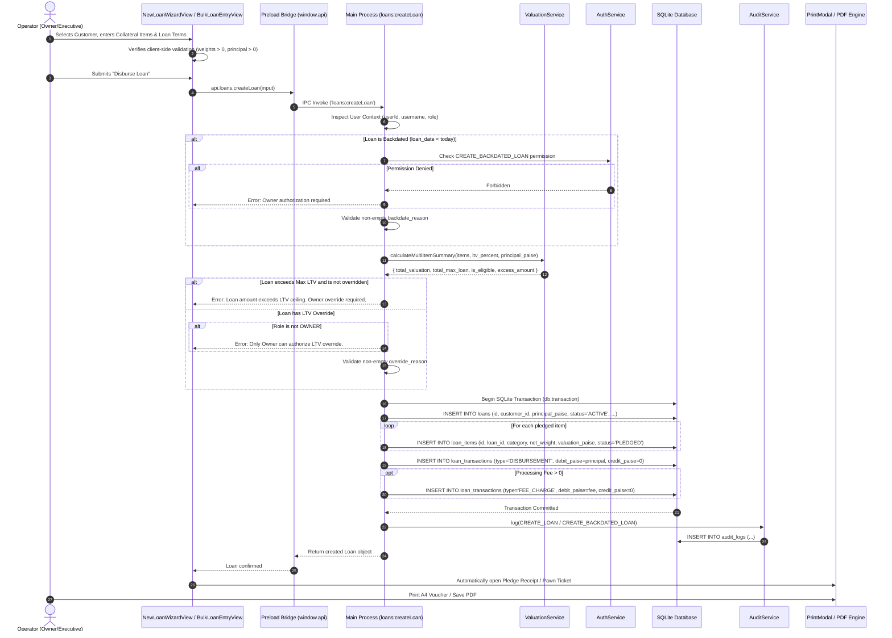
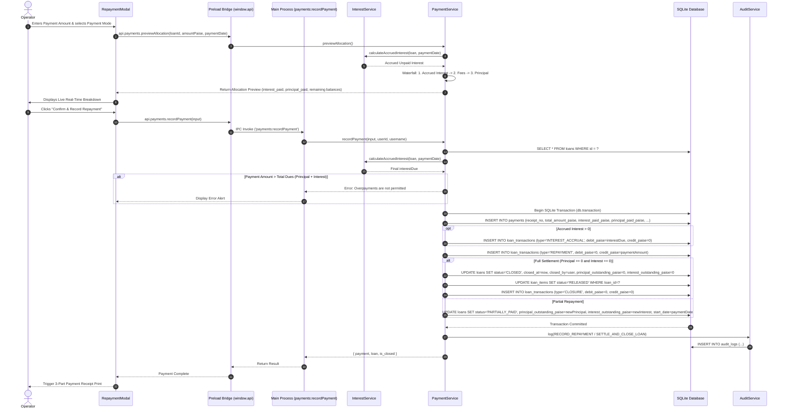
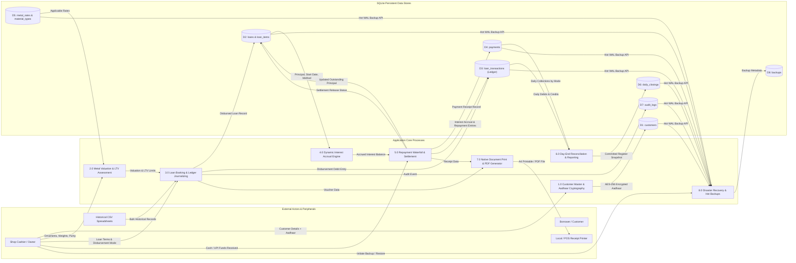
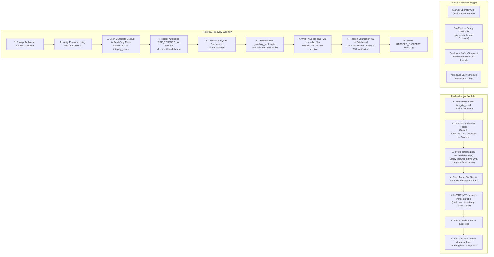

# System Architecture Documentation — SwarnaRaksha Loan Manager

**Document Version:** 1.0.0  
**Application Name:** SwarnaRaksha — Jewellery Loan Vault / Jewellery Loan Management System  
**Product Identifier:** `com.swarnaraksha.jewelleryloanmanager`  
**Execution Context:** Production Desktop Application (100% Offline)  
**Date of Verification:** October 2026  

---

## 1. Architectural Philosophy & Design Principles

SwarnaRaksha is designed as a standalone, zero-network-dependency, high-durability desktop application specifically tailored for Indian jewellery moneylenders, pawn brokers, and gold loan operators. Its architecture adheres to four core design principles:

1. **Air-Gapped Local Operation (Zero Network Exposure):**  
   The application requires zero external APIs, remote databases, cloud microservices, CDNs, or internet connectivity. All business logic, cryptographic operations, reporting, database queries, and document generation run locally on the host machine.
2. **Strict Financial Precision:**  
   Currency values are stored and calculated as 64-bit integer paise (`₹1.00 = 100 paise`), eliminating IEEE 754 floating-point rounding errors. Weights are maintained to milligram precision (3 decimal places, `0.001g`).
3. **Process Isolation & Defense-in-Depth:**  
   Utilizes Electron's multi-process model. The user interface runs in a sandboxed Chromium renderer with Node.js integration disabled. The renderer communicates exclusively with the privileged Node.js main process via strongly typed, pre-authorized Inter-Process Communication (IPC) channels exposed through `contextBridge`.
4. **ACID Financial Integrity & Immutability:**  
   Backed by an embedded SQLite engine operating in Write-Ahead Logging (WAL) mode with mandatory foreign-key enforcement. All financial disbursements, repayments, fee assessments, and adjustments write immutable double-entry ledger records.

---

## 2. High-Level System Architecture Diagram

```mermaid
flowchart TD
    subgraph UI_Renderer ["Chromium Renderer Process (Sandboxed UI)"]
        ReactApp["React 19 SPA (TypeScript)"]
        UI_Router["ActiveTab Navigation State"]
        UI_Context["AuthContext & User Session"]
        UI_Views["Views (Dashboard, Loans, Payments, Reports, etc.)"]
        UI_Print["PrintModal & Print Styles"]
        PreloadBridge["window.api (Electron Preload Bridge)"]
    end

    subgraph IPC_Boundary ["IPC Communication Barrier (contextBridge)"]
        IPC_Invoke["ipcRenderer.invoke()"]
        IPC_Handle["ipcMain.handle()"]
    end

    subgraph Electron_Main ["Electron Main Process (Node.js v24 Runtime)"]
        MainEntry["Main Entry Point (electron/main.ts)"]
        
        subgraph Services ["Application Business Services"]
            AuthSvc["AuthService (RBAC, PBKDF2)"]
            CustSvc["CustomerService (AES-256-GCM)"]
            LoanSvc["LoanService (Lifecycle & Terms)"]
            PaySvc["PaymentService (Waterfall Engine)"]
            ValSvc["ValuationService (Appraisal & LTV)"]
            IntSvc["InterestService (Accrual Engine)"]
            LedgSvc["LedgerService (Double-Entry Ledger)"]
            RateSvc["RateService (Metal Rates & Pro-Rata)"]
            CloseSvc["DailyClosingService (EOD Register)"]
            RepSvc["ReportService (KPIs & CSV Export)"]
            BckSvc["BackupService (Online Hot Backup)"]
            AudSvc["AuditService (Immutable Logging)"]
            CSVSvc["CSVImportService (Historical Import)"]
            CatSvc["CategoryService (Custom Categories)"]
            MatSvc["MaterialTypeService (Purity Config)"]
            SetSvc["SettingService (Shop Config & IDs)"]
        end

        subgraph PDF_Engine ["Headless Print Engine"]
            HiddenWin["Hidden BrowserWindow (A4 printToPDF)"]
        end
    end

    subgraph Data_Layer ["Persistent Storage Layer (Local Disk)"]
        SQLiteDB[("SQLite 3 Database (WAL Mode)\njewellery_vault.sqlite")]
        MasterKeyFile[(".vault_master.key\n(AES-256 Master Key)")]
        BackupsFolder[("Local Backup Archive\n*.sqlite")]
        AppLogFile[("app.log\n(Runtime Error Log)")]
    end

    %% Connections
    ReactApp --> PreloadBridge
    PreloadBridge --> IPC_Invoke
    IPC_Invoke --> IPC_Handle
    IPC_Handle --> MainEntry
    MainEntry --> Services
    MainEntry --> PDF_Engine
    Services --> SQLiteDB
    CustSvc -.-> MasterKeyFile
    BckSvc -.-> BackupsFolder
    MainEntry -.-> AppLogFile
```

---

## 3. Structural Decomposition & Layered Organization

The application codebase is structured across two major directories: `electron/` (main process and business domain services) and `src/` (presentation layer).

### 3.1 Presentation Layer (`src/`)
- **Technology:** React 19.0.0, TypeScript 5.7.3, Tailwind CSS 3.4.17, Lucide React icons.
- **Role:** Renders all graphical user interface views, handles client-side input validation, formats numbers into the Indian numbering system, and renders print preview layouts.
- **Entry Points:** `src/main.tsx` mounts `<App />` from `src/App.tsx`.
- **State Architecture:**
  - `AuthContext.tsx`: Tracks authenticated user profile, active roles (`OWNER` vs `EXECUTIVE`), granular permission set, and setup requirement status.
  - Active Tab Router: Single-page application navigation governed by `activeTab` state in `App.tsx` (`dashboard`, `customers`, `customer-profile`, `new-loan`, `bulk-loan`, `loans`, `loan-details`, `payments`, `valuation`, `rates`, `daily-closing`, `reports`, `users`, `settings`, `backup`, `import-loans`, `audit`).
  - View Components (`src/views/`): 18 specialized view modules handling dedicated business screens.
  - Common Widgets (`src/components/common/`): Reusable UI primitives (`CurrencyInput.tsx`, `WeightInput.tsx`, `Modal.tsx`, `Badge.tsx`, `Button.tsx`).
  - Print Orchestration (`src/components/print/PrintModal.tsx`): Formats 5 distinct printable vouchers and transmits CSS/HTML bundles to the native PDF generator.

### 3.2 Preload Communication Bridge (`electron/preload.ts`)
- **Isolation Mechanism:** Uses `contextBridge.exposeInMainWorld('api', electronApi)`.
- **Security Boundary:** Node.js native globals (`require`, `process`, `fs`, `Buffer`) are not exposed to the DOM window.
- **Contract Definition:** Bridges 60+ distinct asynchronous IPC channels divided into functional namespaces: `auth`, `customers`, `rates`, `categories`, `materialTypes`, `valuation`, `interest`, `loans`, `payments`, `ledger`, `dailyClosing`, `reports`, `settings`, `backups`, `csv`, `audit`, `system`.

### 3.3 Main Process & Application Service Layer (`electron/services/`)
- **Runtime:** Node.js v24.21.0 within Electron 34.2.0.
- **Role:** Orchestrates system lifecycle, initializes database connectivity, validates role-based permissions, runs financial calculations, coordinates transactions, and enforces data encryption.
- **Modules:**
  - `loanService.ts`: Core loan lifecycle (drafting, validation, disbursement, status transitions, overdue processing).
  - `paymentService.ts`: Repayment waterfall engine (accrual settlement, fee coverage, principal reduction, collateral release).
  - `valuationService.ts`: Single-item and multi-item collateral valuation, LTV calculations, and margin analysis.
  - `interestService.ts`: Accrual logic supporting monthly simple, daily simple, and flat interest models.
  - `ledgerService.ts`: Read and compensating-reversal operations on the double-entry `loan_transactions` table.
  - `customerService.ts`: Customer master lifecycle and AES-256-GCM Aadhaar encryption.
  - `cryptoService.ts`: Cryptographic routines (PBKDF2-SHA512 password hashing, constant-time verification, AES-GCM cipher).
  - `backupService.ts`: Hot database backup creation, file integrity checks, automatic backup pruning, and safe restore workflows.
  - `csvImportService.ts`: Offline CSV parsing (RFC 4180), multi-material row grouping, deduplication, and atomic import.
  - `rateService.ts`: Market metal rate history and purity pro-rata fallback engine.
  - `materialTypeService.ts`: Configurable metal purities, fineness specifications, and benchmark rates.
  - `categoryService.ts`: Reusable jewellery article category catalog.
  - `dailyClosingService.ts`: Day-end cash drawer, digital collection, and disbursement reconciliation.
  - `reportService.ts`: Real-time KPI aggregation and tabular CSV reporting.
  - `settingService.ts`: Singleton business settings, legal disclaimers, and human-readable sequence generators.
  - `auditService.ts`: Immutable event logger tracking critical system actions.

### 3.4 Local Persistence Layer (`electron/database/`)
- **Engine:** SQLite 3 via `better-sqlite3` v12.10.1 (native C++ binding).
- **Execution Mode:** Synchronous execution directly within the Electron Node.js process (zero network roundtrip, microsecond latency).
- **Files:**
  - `connection.ts`: Manages database instance, resolves native bindings across development and packaged ASAR environments, executes schema creation and column migrations.
  - `schema.ts`: DDL definitions for all 12 core tables and 18 indexes.
  - `seed.ts`: Bootstraps default owner, staff, categories, rates, material types, and sample loans.

---

## 4. End-to-End Sequence Diagrams

### 4.1 Loan Creation Sequence

---

### 4.2 Repayment & Waterfall Allocation Sequence

---

### 4.3 Data-Flow Diagram (DFD Level 1)

---

### 4.4 Backup & Disaster Recovery Architecture

---

## 5. Operating System Integration & Storage Layout

### 5.1 Storage Locations on Windows
The application establishes storage directories through `electron/database/connection.ts`:
- **Default Database Directory:**  
  `%APPDATA%\jewellery-loan-manager\jewellery_vault.sqlite`  
  *(Resolved via Electron `app.getPath('userData')`)*
- **Master Encryption Key:**  
  `%APPDATA%\jewellery-loan-manager\.vault_master.key`  
  *(Created with restricted permissions `0o600`)*
- **Local Backup Directory:**  
  `%APPDATA%\jewellery-loan-manager\backups\`
- **Application Runtime Log:**  
  `<Working Directory>\app.log`
- **Development / Test Override:**  
  Can be overridden using the environment variable `JEWELERY_DATA_DIR` (e.g. during Vitest test suite runs).

### 5.2 Operating System Level Controls
- **GPU Cache Lockdown:**  
  In `electron/main.ts`, the command-line switch `--disable-gpu-shader-disk-cache` is appended to prevent Windows `EBUSY` file locking errors on the `%APPDATA%\jewellery-loan-manager\GPUCache` directory.
- **Window Navigation Restrictions:**  
  The Electron `BrowserWindow` enforces `will-navigate` event interception, terminating any attempt to navigate to URLs other than `file://` or the local Vite development server (`http://localhost:5173`).
- **Window Open Prevention:**  
  `webContents.setWindowOpenHandler` returns `{ action: 'deny' }` for all attempts to launch child browser windows or popups.

---

## 6. Verification & Source Evidence Traceability

| Architectural Characteristic | Implementation File | Source Evidence / Function Name | Verification Status |
| :--- | :--- | :--- | :--- |
| Multi-Process Isolation | `electron/main.ts` | `createWindow()`, `webPreferences: { contextIsolation: true, nodeIntegration: false }` | Verified in Source |
| Preload IPC Security | `electron/preload.ts` | `contextBridge.exposeInMainWorld('api', electronApi)` | Verified in Source |
| SQLite WAL & Foreign Keys | `electron/database/connection.ts` | `dbInstance.pragma('journal_mode = WAL'); dbInstance.pragma('foreign_keys = ON')` | Verified in Source |
| Native Online Backup API | `electron/services/backupService.ts` | `await db.backup(destPath); db.pragma('integrity_check')` | Verified in Tests (`backup_restore.test.ts`) |
| Strict Waterfall Allocation | `electron/services/paymentService.ts` | `PaymentService.recordPayment()`, `previewAllocation()` | Verified in Tests (`waterfall.test.ts`, `repayment_workflow.test.ts`) |
| Double-Entry Journaling | `electron/services/ledgerService.ts` | `loan_transactions` table insertion, `reverseTransaction()` | Verified in Tests (`ledger_immutability.test.ts`) |
| Headless PDF Printing | `electron/main.ts` | `ipcMain.handle('system:downloadPDF')`, `printToPDF()` | Verified in Source & UI |
