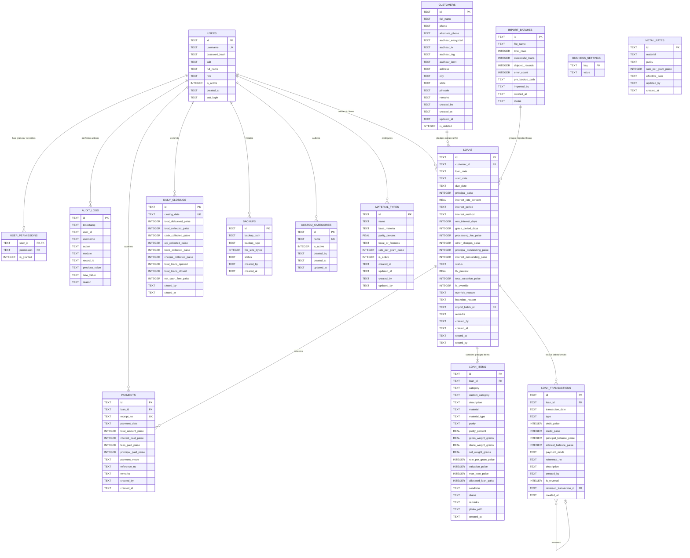

# Database Architecture & Schema Reference — SwarnaRaksha Loan Manager

**Document Version:** 1.0.0  
**Database Engine:** SQLite 3 (via `better-sqlite3` v12.10.1)  
**Storage Engine Mode:** Write-Ahead Logging (WAL)  
**Precision Standard:** 64-bit Integer Paise (Currency) & 3-Decimal Milligrams (Weights)  
**Source Evidence Files:** `electron/database/schema.ts`, `electron/database/connection.ts`, `electron/database/seed.ts`  

---

## 1. Executive Summary & Engine Configuration

SwarnaRaksha employs an embedded, zero-configuration **SQLite 3** database managed via the high-performance native C++ library `better-sqlite3`. The database runs strictly in-process with synchronous execution, ensuring zero inter-process network overhead and sub-millisecond query execution.

### 1.1 Performance & Durability PRAGMAs
Configured in `electron/database/connection.ts` (lines 66–68):

```sql
PRAGMA journal_mode = WAL;
PRAGMA foreign_keys = ON;
PRAGMA synchronous = NORMAL;
```

- **`journal_mode = WAL` (Write-Ahead Logging):** Enables concurrent reads while writing occurs. Multiple read transactions proceed without blocking writing transactions, and writes do not block readers. WAL is essential for high-responsiveness in desktop environments.
- **`foreign_keys = ON`:** Explicitly enforced on every database connection. By default, SQLite has foreign key constraints disabled; SwarnaRaksha mandates constraint validation to preserve relational integrity.
- **`synchronous = NORMAL`:** Provides optimal ACID durability in WAL mode without the performance penalty of frequent disk flushes on every synchronous write.

### 1.2 Storage Path Resolution
The absolute path to the active SQLite database is determined dynamically in `electron/database/connection.ts` (lines 10–19):
- **Production Desktop Environment:**  
  `path.join(app.getPath('userData'), 'jewellery_vault.sqlite')`  
  On Windows, this resolves to `%APPDATA%\jewellery-loan-manager\jewellery_vault.sqlite`.
- **Environment Override / Automated Testing:**  
  If the environment variable `JEWELERY_DATA_DIR` is defined, the database is instantiated inside that directory. If `app` is unavailable (e.g. CLI runner), it defaults to `path.join(process.cwd(), 'data', 'jewellery_vault.sqlite')`.
- **Accompanying WAL and Shared Memory Files:**  
  Under WAL mode, SQLite generates `jewellery_vault.sqlite-wal` (write journal) and `jewellery_vault.sqlite-shm` (index memory map) in the same directory.

---

## 2. Complete Entity-Relationship Diagram (ERD)

The following Mermaid ERD represents the verified relational schema implemented in `electron/database/schema.ts`:



---

## 3. Comprehensive Entity & Table Reference

### 3.1 `users`
Stores system operators, credentials, and master role assignments.

| Column | Type | Constraints | Description |
| :--- | :--- | :--- | :--- |
| `id` | TEXT | PRIMARY KEY | Unique user identifier (`USR-timestamp-hex`) |
| `username` | TEXT | UNIQUE NOT NULL | Alphanumeric lowercase login username |
| `password_hash` | TEXT | NOT NULL | PBKDF2-SHA512 derived hash (100,000 iterations, 64-byte key) |
| `salt` | TEXT | NOT NULL | Cryptographic random 16-byte hex salt |
| `full_name` | TEXT | NOT NULL | Full name of employee or shop owner |
| `role` | TEXT | NOT NULL CHECK(role IN ('OWNER', 'EXECUTIVE')) | Role tier governing default authority |
| `is_active` | INTEGER | NOT NULL DEFAULT 1 | Account status (1 = Active, 0 = Deactivated) |
| `created_at` | TEXT | NOT NULL | ISO8601 registration timestamp |
| `last_login` | TEXT | NULL | ISO8601 timestamp of previous successful login |

---

### 3.2 `user_permissions`
Manages granular permission overrides for individual user accounts.

| Column | Type | Constraints | Description |
| :--- | :--- | :--- | :--- |
| `user_id` | TEXT | NOT NULL REFERENCES users(id) ON DELETE CASCADE | Associated user ID |
| `permission` | TEXT | NOT NULL | Action permission key (e.g. `CREATE_BACKDATED_LOAN`) |
| `is_granted` | INTEGER | NOT NULL DEFAULT 1 | Override flag (1 = Granted, 0 = Denied) |

**Composite Primary Key:** `(user_id, permission)`

---

### 3.3 `business_settings`
Key-value configuration store for business metadata, financial defaults, and sequence prefixes.

| Column | Type | Constraints | Description |
| :--- | :--- | :--- | :--- |
| `key` | TEXT | PRIMARY KEY | Configuration setting key name |
| `value` | TEXT | NOT NULL | JSON-encoded or string value |

**Managed Keys:**  
`business_name`, `tagline`, `address`, `city`, `state`, `pincode`, `phone`, `email`, `gst_number`, `registration_number`, `receipt_header`, `receipt_footer`, `terms_conditions`, `default_interest_rate_percent`, `default_interest_method`, `default_interest_period`, `default_ltv_percent`, `default_min_interest_days`, `default_grace_period_days`, `loan_prefix`, `customer_prefix`, `receipt_prefix`, `auto_backup_enabled`, `backup_folder_path`, `inactivity_timeout_minutes`.

---

### 3.4 `metal_rates`
Historical log of gold and silver market valuation rates.

| Column | Type | Constraints | Description |
| :--- | :--- | :--- | :--- |
| `id` | TEXT | PRIMARY KEY | Unique rate ID (`RATE-timestamp-hex`) |
| `material` | TEXT | NOT NULL CHECK(material IN ('GOLD', 'SILVER', 'OTHER')) | Precious metal category |
| `purity` | TEXT | NOT NULL | Karatage or fineness token (`24K`, `22K`, `18K`, `999`, `925`, etc.) |
| `rate_per_gram_paise`| INTEGER | NOT NULL | Applicable rate in integer paise per gram |
| `effective_date` | TEXT | NOT NULL | ISO8601 effective timestamp |
| `updated_by` | TEXT | NOT NULL | Username of author who adjusted rate |
| `created_at` | TEXT | NOT NULL | Record creation timestamp |

---

### 3.5 `customers`
Master customer profiles with encrypted identification data.

| Column | Type | Constraints | Description |
| :--- | :--- | :--- | :--- |
| `id` | TEXT | PRIMARY KEY | Sequential ID (`CUST-000001`) |
| `full_name` | TEXT | NOT NULL | Full legal customer name |
| `phone` | TEXT | NOT NULL | Primary 10-digit mobile number |
| `alternate_phone` | TEXT | NULL | Secondary phone or emergency contact |
| `aadhaar_encrypted`| TEXT | NULL | AES-256-GCM ciphertext of full 12-digit Aadhaar number |
| `aadhaar_iv` | TEXT | NULL | 12-byte initialization vector (hex) |
| `aadhaar_tag` | TEXT | NULL | 16-byte authentication tag (hex) |
| `aadhaar_last4` | TEXT | NOT NULL | Plaintext last 4 digits for indexing and UI display |
| `address` | TEXT | NOT NULL | Residential address |
| `city` | TEXT | NOT NULL | City |
| `state` | TEXT | NOT NULL | State |
| `pincode` | TEXT | NOT NULL | Postal PIN code |
| `remarks` | TEXT | NULL | Reputation or KYC notes |
| `created_by` | TEXT | NOT NULL | Operator username |
| `created_at` | TEXT | NOT NULL | Registration ISO8601 timestamp |
| `updated_at` | TEXT | NOT NULL | Last modification timestamp |
| `is_deleted` | INTEGER | NOT NULL DEFAULT 0 | Soft deletion flag (0 = Active, 1 = Deleted) |

---

### 3.6 `loans`
Principal pawn contracts backed by jewellery collateral.

| Column | Type | Constraints | Description |
| :--- | :--- | :--- | :--- |
| `id` | TEXT | PRIMARY KEY | Sequential loan ID (`LN-YYYY-000001`) |
| `customer_id` | TEXT | NOT NULL REFERENCES customers(id) | Debtor customer foreign key |
| `loan_date` | TEXT | NOT NULL | Official contract disbursement date (`YYYY-MM-DD`) |
| `start_date` | TEXT | NOT NULL | Dynamic interest accrual reference date |
| `due_date` | TEXT | NOT NULL | Loan contract maturity date |
| `principal_paise` | INTEGER | NOT NULL | Initial principal loan disbursed in integer paise |
| `interest_rate_percent` | REAL | NOT NULL | Interest rate percentage (e.g. 2.0) |
| `interest_period` | TEXT | NOT NULL CHECK(interest_period IN ('MONTHLY', 'YEARLY', 'DAILY')) | Tenure accrual period |
| `interest_method` | TEXT | NOT NULL CHECK(interest_method IN ('MONTHLY_SIMPLE', 'DAILY_SIMPLE', 'FLAT')) | Accrual mathematical model |
| `min_interest_days` | INTEGER | NOT NULL DEFAULT 15 | Minimum interest lock duration |
| `grace_period_days`| INTEGER | NOT NULL DEFAULT 7 | Post-maturity grace days before OVERDUE status |
| `processing_fee_paise` | INTEGER | NOT NULL DEFAULT 0 | Upfront processing charge in paise |
| `other_charges_paise` | INTEGER | NOT NULL DEFAULT 0 | Documentation / stamp charges in paise |
| `principal_outstanding_paise` | INTEGER | NOT NULL | Current unpaid principal balance in paise |
| `interest_outstanding_paise` | INTEGER | NOT NULL | Accumulated unpaid interest balance in paise |
| `status` | TEXT | NOT NULL CHECK(status IN ('DRAFT', 'ACTIVE', 'PARTIALLY_PAID', 'OVERDUE', 'CLOSED', 'CANCELLED')) | Operational lifecycle status |
| `ltv_percent` | REAL | NOT NULL | Applied Loan-to-Value percentage |
| `total_valuation_paise` | INTEGER | NOT NULL | Appraised market value of all collateral items |
| `is_override` | INTEGER | NOT NULL DEFAULT 0 | Flag indicating LTV ceiling was overridden (1 = Yes) |
| `override_reason` | TEXT | NULL | Mandatory explanation if LTV overridden |
| `backdate_reason` | TEXT | NULL | Mandatory reason if loan date precedes creation timestamp |
| `import_batch_id` | TEXT | NULL | Pointer to import batch if imported via historical CSV |
| `remarks` | TEXT | NULL | Loan notes and disbursement comments |
| `created_by` | TEXT | NOT NULL | Creator operator username |
| `created_at` | TEXT | NOT NULL | System record creation timestamp |
| `closed_at` | TEXT | NULL | Full settlement and closure timestamp |
| `closed_by` | TEXT | NULL | Username of operator who executed final closure |

---

### 3.7 `custom_categories`
Catalog of customizable jewellery article categories reusable across loans.

| Column | Type | Constraints | Description |
| :--- | :--- | :--- | :--- |
| `id` | TEXT | PRIMARY KEY | Category identifier (`CAT-hex`) |
| `name` | TEXT | UNIQUE COLLATE NOCASE NOT NULL | Category name (e.g. `Waist Chain`, `Brooch`) |
| `is_active` | INTEGER | NOT NULL DEFAULT 1 | Active toggle (1 = Active, 0 = Inactive) |
| `created_by` | TEXT | NOT NULL | Creator username |
| `created_at` | TEXT | NOT NULL | Creation timestamp |
| `updated_at` | TEXT | NOT NULL | Modification timestamp |

---

### 3.8 `material_types`
Master configurations for metal purities, fineness, and default valuation rates.

| Column | Type | Constraints | Description |
| :--- | :--- | :--- | :--- |
| `id` | TEXT | PRIMARY KEY | Material type identifier (`MT-GOLD-22K`, etc.) |
| `name` | TEXT | NOT NULL | Display name (`22K Gold`, `Silver 925`) |
| `base_material` | TEXT | NOT NULL CHECK(base_material IN ('GOLD', 'SILVER', 'OTHER')) | Parent bullion commodity |
| `purity_percent` | REAL | NOT NULL | Exact purity percentage (e.g. `91.67`, `92.50`) |
| `karat_or_fineness` | TEXT | NULL | Karat or millesimal fineness string (`22K`, `925`) |
| `rate_per_gram_paise`| INTEGER | DEFAULT 0 | Default valuation rate in paise per gram |
| `is_active` | INTEGER | NOT NULL DEFAULT 1 | Active status toggle |
| `created_at` | TEXT | NOT NULL | Creation timestamp |
| `updated_at` | TEXT | NOT NULL | Last updated timestamp |
| `created_by` | TEXT | NOT NULL | Creating username |
| `updated_by` | TEXT | NOT NULL | Updating username |

---

### 3.9 `loan_items`
Pledged jewellery articles held in vault custody under a loan contract.

| Column | Type | Constraints | Description |
| :--- | :--- | :--- | :--- |
| `id` | TEXT | PRIMARY KEY | Item identifier (`LN-...-ITM-1`) |
| `loan_id` | TEXT | NOT NULL REFERENCES loans(id) ON DELETE CASCADE | Associated loan |
| `category` | TEXT | NOT NULL | Article category (`Ring`, `Chain`, `Other Article`) |
| `custom_category` | TEXT | NULL | Custom category name when category is 'Other Article' |
| `description` | TEXT | NOT NULL | Detailed visual description, hallmarks, and markings |
| `material` | TEXT | NOT NULL CHECK(material IN ('GOLD', 'SILVER', 'OTHER')) | Base metal category |
| `material_type` | TEXT | NULL | Material type name (`22K Gold`, `Silver 925`) |
| `purity` | TEXT | NOT NULL | Karat / Fineness designation |
| `purity_percent` | REAL | NULL | Pure metal percentage snapshot |
| `gross_weight_grams`| REAL | NOT NULL | Physical scale weight with stones (grams) |
| `stone_weight_grams`| REAL | NOT NULL DEFAULT 0 | Tare weight of stones/beads/wax (grams) |
| `net_weight_grams` | REAL | NOT NULL | Pure precious metal weight: `Gross - Stone` |
| `rate_per_gram_paise`| INTEGER | NOT NULL | Applied valuation rate in paise per gram |
| `valuation_paise` | INTEGER | NOT NULL | Item appraised value: `Net Weight * Rate` |
| `max_loan_paise` | INTEGER | NOT NULL | Maximum loan capacity: `Valuation * LTV%` |
| `allocated_loan_paise`| INTEGER | NOT NULL | Allocated portion of principal disbursed |
| `condition` | TEXT | NOT NULL DEFAULT 'GOOD' | Physical condition (`EXCELLENT`, `GOOD`, `FAIR`, `SCRAP`) |
| `status` | TEXT | NOT NULL CHECK(status IN ('PLEDGED', 'RELEASED', 'UNDER_DISPUTE', 'SEIZED')) | Custody status in vault |
| `remarks` | TEXT | NULL | Gemstone details, damage notes, or hallmarks |
| `photo_path` | TEXT | NULL | Local vault image capture file path |
| `created_at` | TEXT | NOT NULL | Record creation timestamp |

---

### 3.10 `loan_transactions`
Double-entry immutable financial ledger recording every financial event on a loan.

| Column | Type | Constraints | Description |
| :--- | :--- | :--- | :--- |
| `id` | TEXT | PRIMARY KEY | Transaction ledger ID (`TX-timestamp-hex`) |
| `loan_id` | TEXT | NOT NULL REFERENCES loans(id) | Associated loan |
| `transaction_date` | TEXT | NOT NULL | Effective transaction posting date (`YYYY-MM-DD`) |
| `type` | TEXT | NOT NULL CHECK(type IN ('DISBURSEMENT', 'INTEREST_ACCRUAL', 'REPAYMENT', 'FEE_CHARGE', 'PENALTY', 'REVERSAL', 'ADJUSTMENT', 'CLOSURE')) | Classification of entry |
| `debit_paise` | INTEGER | NOT NULL DEFAULT 0 | Debit amount in paise |
| `credit_paise` | INTEGER | NOT NULL DEFAULT 0 | Credit amount in paise |
| `principal_balance_paise`| INTEGER | NOT NULL | Running principal balance immediately after transaction |
| `interest_balance_paise`| INTEGER | NOT NULL | Running interest balance immediately after transaction |
| `payment_mode` | TEXT | NULL CHECK(payment_mode IN ('CASH', 'UPI', 'BANK_TRANSFER', 'CHEQUE', 'OTHER')) | Channel of payment |
| `reference_no` | TEXT | NULL | UTR number, cheque number, or receipt voucher ID |
| `description` | TEXT | NOT NULL | Explanatory narrative of posting |
| `created_by` | TEXT | NOT NULL | Author username |
| `is_reversal` | INTEGER | NOT NULL DEFAULT 0 | Flag indicating transaction is reversed or is a reversal |
| `reversed_transaction_id`| TEXT | NULL | Pointer to original transaction if this is a reversal |
| `created_at` | TEXT | NOT NULL | Record creation timestamp |

---

### 3.11 `payments`
Receipt vouchers for incoming cash, digital, or banking repayments.

| Column | Type | Constraints | Description |
| :--- | :--- | :--- | :--- |
| `id` | TEXT | PRIMARY KEY | Unique payment ID (`PAY-timestamp-hex`) |
| `loan_id` | TEXT | NOT NULL REFERENCES loans(id) | Associated loan contract |
| `receipt_no` | TEXT | UNIQUE NOT NULL | Human-readable voucher sequence (`RCP-YYYY-000001`) |
| `payment_date` | TEXT | NOT NULL | Receipt date (`YYYY-MM-DD`) |
| `total_amount_paise` | INTEGER | NOT NULL | Total gross funds received in paise |
| `interest_paid_paise`| INTEGER | NOT NULL | Portion allocated to satisfy accrued interest |
| `fees_paid_paise` | INTEGER | NOT NULL | Portion allocated to pending charges |
| `principal_paid_paise`| INTEGER | NOT NULL | Portion allocated to reduce principal debt |
| `payment_mode` | TEXT | NOT NULL CHECK(payment_mode IN ('CASH', 'UPI', 'BANK_TRANSFER', 'CHEQUE', 'OTHER')) | Payment channel |
| `reference_no` | TEXT | NULL | Banking UTR / Cheque reference |
| `remarks` | TEXT | NULL | Repayment notes |
| `created_by` | TEXT | NOT NULL | Cashier username |
| `created_at` | TEXT | NOT NULL | Record creation timestamp |

---

### 3.12 `daily_closings`
End-of-day register snapshots reconciling disbursements, receipts, and cash flows.

| Column | Type | Constraints | Description |
| :--- | :--- | :--- | :--- |
| `id` | TEXT | PRIMARY KEY | Closing record ID (`DC-YYYY-MM-DD-hex`) |
| `closing_date` | TEXT | UNIQUE NOT NULL | Business date (`YYYY-MM-DD`) |
| `total_disbursed_paise`| INTEGER | NOT NULL DEFAULT 0 | Total capital disbursed during date |
| `total_collected_paise`| INTEGER | NOT NULL DEFAULT 0 | Total collections received during date |
| `cash_collected_paise` | INTEGER | NOT NULL DEFAULT 0 | Cash drawer receipts |
| `upi_collected_paise` | INTEGER | NOT NULL DEFAULT 0 | UPI collections |
| `bank_collected_paise` | INTEGER | NOT NULL DEFAULT 0 | Bank transfer receipts |
| `cheque_collected_paise`| INTEGER | NOT NULL DEFAULT 0 | Cheque receipts |
| `total_loans_opened` | INTEGER | NOT NULL DEFAULT 0 | Count of new loans opened |
| `total_loans_closed` | INTEGER | NOT NULL DEFAULT 0 | Count of loans settled & closed |
| `net_cash_flow_paise` | INTEGER | NOT NULL DEFAULT 0 | `Total Collected - Total Disbursed` |
| `closed_by` | TEXT | NOT NULL | Closing manager username |
| `closed_at` | TEXT | NOT NULL | Official commitment timestamp |

---

### 3.13 `audit_logs`
Append-only, immutable activity log tracking all security and financial actions.

| Column | Type | Constraints | Description |
| :--- | :--- | :--- | :--- |
| `id` | TEXT | PRIMARY KEY | Unique log token (`AUD-timestamp-hex`) |
| `timestamp` | TEXT | NOT NULL | ISO8601 activity timestamp |
| `user_id` | TEXT | NOT NULL | Operator user ID |
| `username` | TEXT | NOT NULL | Operator username |
| `action` | TEXT | NOT NULL | Activity verb (`CREATE_LOAN`, `RECORD_REPAYMENT`, `VIEW_SENSITIVE_AADHAAR`, `RESTORE_DATABASE`, etc.) |
| `module` | TEXT | NOT NULL | Subsystem (`AUTH`, `CUSTOMERS`, `LOANS`, `PAYMENTS`, `SETTINGS`, `BACKUP`) |
| `record_id` | TEXT | NULL | Primary key of modified entity |
| `previous_value` | TEXT | NULL | JSON-encoded snapshot of state before modification |
| `new_value` | TEXT | NULL | JSON-encoded snapshot of state after modification |
| `reason` | TEXT | NULL | Justification for sensitive adjustments or overrides |

---

### 3.14 `backups`
Metadata register of created database backups.

| Column | Type | Constraints | Description |
| :--- | :--- | :--- | :--- |
| `id` | TEXT | PRIMARY KEY | Backup record ID (`BCK-timestamp-hex`) |
| `backup_path` | TEXT | NOT NULL | Absolute file system path of backup archive |
| `backup_type` | TEXT | NOT NULL CHECK(backup_type IN ('MANUAL', 'AUTOMATIC', 'PRE_RESTORE')) | Backup trigger source |
| `file_size_bytes` | INTEGER | NOT NULL | Exact size in bytes |
| `status` | TEXT | NOT NULL | Snapshot status (`SUCCESS` or `FAILED`) |
| `created_by` | TEXT | NOT NULL | Username or system |
| `created_at` | TEXT | NOT NULL | Timestamp |

---

### 3.15 `import_batches`
Audit registry tracking historical loan CSV migration sessions.

| Column | Type | Constraints | Description |
| :--- | :--- | :--- | :--- |
| `id` | TEXT | PRIMARY KEY | Batch token (`IMP-YYYY-HEX`) |
| `file_name` | TEXT | NOT NULL | Name of imported CSV file |
| `total_rows` | INTEGER | NOT NULL | Number of rows processed |
| `successful_loans` | INTEGER | NOT NULL | Distinct loan contracts created |
| `skipped_records` | INTEGER | NOT NULL DEFAULT 0 | Duplicate or skipped rows |
| `error_count` | INTEGER | NOT NULL DEFAULT 0 | Error count encountered |
| `pre_backup_path` | TEXT | NULL | Path to safety backup created prior to import |
| `imported_by` | TEXT | NOT NULL | Importing operator username |
| `created_at` | TEXT | NOT NULL | Batch execution timestamp |
| `status` | TEXT | NOT NULL CHECK(status IN ('COMPLETED', 'PARTIALLY_COMPLETED', 'FAILED', 'ROLLED_BACK')) | Import outcome status |

---

## 4. Query Optimization & Indexes

The following 18 indexes are defined in `electron/database/schema.ts` to maintain sub-millisecond query performance over hundreds of thousands of records:

```sql
-- Customers Indexes
CREATE INDEX IF NOT EXISTS idx_customers_phone ON customers(phone);
CREATE INDEX IF NOT EXISTS idx_customers_name ON customers(full_name);
CREATE INDEX IF NOT EXISTS idx_customers_aadhaar4 ON customers(aadhaar_last4);

-- Loans Indexes
CREATE INDEX IF NOT EXISTS idx_loans_customer ON loans(customer_id);
CREATE INDEX IF NOT EXISTS idx_loans_status ON loans(status);
CREATE INDEX IF NOT EXISTS idx_loans_due_date ON loans(due_date);
CREATE INDEX IF NOT EXISTS idx_loans_created_at ON loans(created_at);

-- Collateral Items Indexes
CREATE INDEX IF NOT EXISTS idx_loan_items_loan ON loan_items(loan_id);
CREATE INDEX IF NOT EXISTS idx_loan_items_status ON loan_items(status);
CREATE INDEX IF NOT EXISTS idx_loan_items_material ON loan_items(material);

-- Ledger & Transactions Indexes
CREATE INDEX IF NOT EXISTS idx_loan_tx_loan ON loan_transactions(loan_id);
CREATE INDEX IF NOT EXISTS idx_loan_tx_date ON loan_transactions(transaction_date);

-- Payments Indexes
CREATE INDEX IF NOT EXISTS idx_payments_loan ON payments(loan_id);
CREATE INDEX IF NOT EXISTS idx_payments_receipt ON payments(receipt_no);
CREATE INDEX IF NOT EXISTS idx_payments_date ON payments(payment_date);

-- Custom Categories & Material Types Indexes
CREATE INDEX IF NOT EXISTS idx_custom_categories_name ON custom_categories(name);
CREATE INDEX IF NOT EXISTS idx_material_types_base ON material_types(base_material, is_active);

-- Rates & Audit Logs Indexes
CREATE INDEX IF NOT EXISTS idx_metal_rates_mat_purity ON metal_rates(material, purity, effective_date);
CREATE INDEX IF NOT EXISTS idx_audit_timestamp ON audit_logs(timestamp);
CREATE INDEX IF NOT EXISTS idx_audit_module ON audit_logs(module);
CREATE INDEX IF NOT EXISTS idx_audit_record ON audit_logs(record_id);
CREATE INDEX IF NOT EXISTS idx_import_batches_created ON import_batches(created_at);
```

---

## 5. Non-Destructive Migrations & Backward Compatibility

In `electron/database/connection.ts` (lines 74–119), runtime introspection inspects existing table schemas upon database startup. If columns introduced in later revisions are missing, `ALTER TABLE ... ADD COLUMN` statements execute non-destructively:

1. **`loans` Table Migration:**  
   - Inspects `PRAGMA table_info(loans)`.  
   - Adds `backdate_reason TEXT` if missing.  
   - Adds `import_batch_id TEXT` if missing.
2. **`loan_items` Table Migration:**  
   - Inspects `PRAGMA table_info(loan_items)`.  
   - Adds `custom_category TEXT` if missing.  
   - Adds `material_type TEXT` if missing.  
   - Adds `purity_percent REAL` if missing.
3. **Historical Data Backfilling:**  
   - Automatically backfills `material_type` and `purity_percent` for legacy loan items based on `purity` values (e.g. `22K` -> `22K Gold`, `91.67%`; `925` -> `Silver 925`, `92.50%`).

---

## 6. Discrepancy Analysis: Actual Code vs Legacy Documentation

A comparison between the legacy `DATABASE_SCHEMA.md` and the actual source code (`electron/database/schema.ts`) reveals several important differences:

| Entity / Property | Legacy `DATABASE_SCHEMA.md` | Actual Implementation in `schema.ts` | Technical Rationale & Impact |
| :--- | :--- | :--- | :--- |
| `business_settings` | Single row with fixed columns (`id INTEGER CHECK(id = 1), business_name TEXT ...`) | Key-Value Table (`key TEXT PRIMARY KEY, value TEXT NOT NULL`) | Code uses flexible JSON key-value store, allowing dynamic additions without schema changes. |
| `custom_categories` | Not documented in legacy schema | Implemented as standalone entity `custom_categories` | Added to support user-defined jewellery articles (`Nose Pin`, `Brooch`, etc.) with unique case-insensitive names. |
| `material_types` | Not documented in legacy schema | Implemented as standalone entity `material_types` | Enables Owner-configured purity percentages, fineness definitions, and benchmark rates. |
| `import_batches` | Not documented in legacy schema | Implemented as standalone entity `import_batches` | Tracks historical loan CSV import sessions and stores pre-import backup paths. |
| `loans.backdate_reason` | Not documented in legacy schema | Implemented as nullable `TEXT` | Stores mandatory justification when loan date precedes creation timestamp. |
| `loans.import_batch_id` | Not documented in legacy schema | Implemented as nullable `TEXT` | Links imported loans to their corresponding batch audit record. |
| `loan_items` Columns | Only standard category, material, purity | Contains `custom_category`, `material_type`, `purity_percent` | Captures detailed purity snapshots and custom category bindings. |

*Treat the actual source code (`schema.ts` and `connection.ts`) as the authoritative ground truth.*
