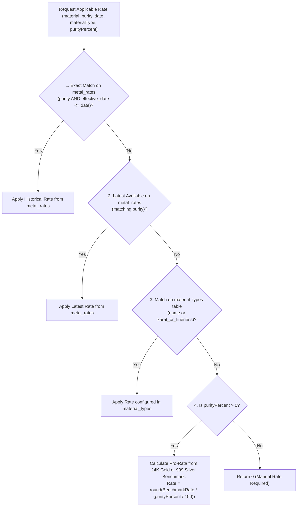
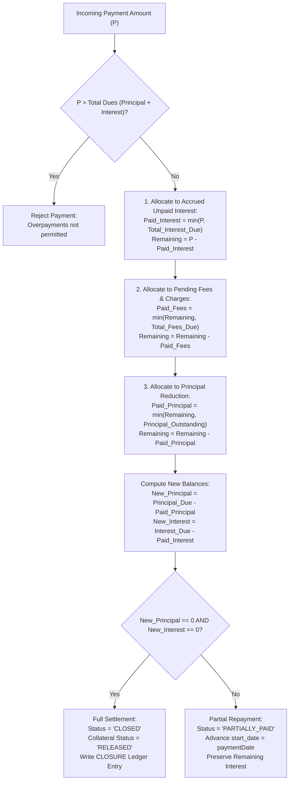

# Financial Logic, Algorithms, & Formulas Reference — SwarnaRaksha Loan Manager

**Document Version:** 1.0.0  
**Implementation Source Files:**  
- `electron/services/valuationService.ts`  
- `electron/services/interestService.ts`  
- `electron/services/paymentService.ts`  
- `electron/services/rateService.ts`  
- `electron/services/loanService.ts`  
- `src/utils/currency.ts`  
- `src/utils/purity.ts`  
**Test Suite Verification:** `tests/valuation.test.ts`, `tests/interest.test.ts`, `tests/waterfall.test.ts`, `tests/repayment_workflow.test.ts`, `tests/currency.test.ts`  

---

## 1. Core Financial Precision Principles

Financial applications handling physical bullion collateral and credit risk cannot tolerate IEEE 754 double-precision binary floating-point representation (`0.1 + 0.2 !== 0.3`). SwarnaRaksha implements two foundational precision rules:

1. **Integer Paise Currency Representation:**  
   All currency values—including principal disbursed, valuations, metal rates, repayment amounts, fees, and interest balances—are represented and calculated as **64-bit integer paise** (`INTEGER` in SQLite):
   $$\text{₹1.00} = 100\text{ paise}$$
   Floating-point arithmetic is never used for currency storage or balance reconciliation.
2. **Fixed 3-Decimal Milligram Weight Precision:**  
   All weights (gross, stone tare, and net precious metal) are maintained to three decimal places (`0.001g` = 1 milligram accuracy), matching certified analytical electronic balances used in jewellery trade.

---

## 2. Jewellery Weights & Net Metal Calculations

### 2.1 Mathematical Formula
The pure precious metal weight is calculated by subtracting tare weight (non-metal components such as gemstones, lac, wax, beads, and enamels) from the gross scale weight:

$$\text{Net Weight (grams)} = \max\left(0, \text{round}(\text{Gross Weight} - \text{Stone Weight}, 3)\right)$$

### 2.2 Variables & Domain Rules
| Variable | Unit | Type | Validation Constraint | Description |
| :--- | :--- | :--- | :--- | :--- |
| `grossWeightGrams` | Grams (g) | `number` (3 dec) | $> 0$ | Total scale weight of ornament including all stones |
| `stoneWeightGrams` | Grams (g) | `number` (3 dec) | $\ge 0$ and $< \text{Gross Weight}$ | Total estimated weight of non-precious components |
| `netWeight` | Grams (g) | `number` (3 dec) | $> 0$ | Weight of precious bullion eligible for valuation |

### 2.3 Implementation Evidence
From `electron/services/valuationService.ts` (lines 38–54):
```typescript
if (grossWeightGrams <= 0) errors.push('Gross weight must be greater than zero');
if (stoneWeightGrams < 0) errors.push('Stone weight cannot be negative');
if (stoneWeightGrams >= grossWeightGrams) errors.push('Stone weight cannot be greater than or equal to gross weight');

const netWeight = Math.max(0, +(grossWeightGrams - (stoneWeightGrams || 0)).toFixed(3));
```

### 2.4 Worked Example
- Gross Weight: `24.550 g`
- Stone Tare: `1.200 g`
$$\text{Net Weight} = 24.550 - 1.200 = 23.350\text{ g}$$

---

## 3. Bullion Purity & Caratage Relationships

### 3.1 Mathematical Formulas
In Indian bullion markets, gold purity is expressed in Karats (parts out of 24), and silver purity is expressed as millesimal fineness (parts out of 1000).

#### Gold Purity Percentage:
$$\text{Gold Purity (\%)} = \text{round}\left(\frac{\text{Karat}}{24} \times 100, 2\right)$$

#### Silver Purity Percentage:
$$\text{Silver Purity (\%)} = \text{round}\left(\frac{\text{Fineness}}{1000} \times 100, 2\right) = \text{round}\left(\frac{\text{Fineness}}{10}, 2\right)$$

### 3.2 Standard Purity Conversion Table

| Metal | Designator | Karat / Fineness | Pure Metal Ratio | Standard Purity % | Default Benchmark Rate (Paise/g) | Default Benchmark Rate (INR/g) |
| :--- | :--- | :--- | :--- | :--- | :--- | :--- |
| **Gold** | 24K Gold | 24 / 24 | 1.0000 | **100.00%** | 760,000 | ₹7,600.00 |
| **Gold** | 22K Gold | 22 / 24 | 0.9167 | **91.67%** | 700,000 | ₹7,000.00 |
| **Gold** | 20K Gold | 20 / 24 | 0.8333 | **83.33%** | 635,000 | ₹6,350.00 |
| **Gold** | 18K Gold | 18 / 24 | 0.7500 | **75.00%** | 570,000 | ₹5,700.00 |
| **Gold** | 16K Gold | 16 / 24 | 0.6667 | **66.67%** | 506,700 | ₹5,067.00 |
| **Gold** | 14K Gold | 14 / 24 | 0.5833 | **58.33%** | 443,300 | ₹4,433.00 |
| **Silver**| Silver 999 | 999 / 1000 | 0.9990 | **99.90%** | 9,500 | ₹95.00 |
| **Silver**| Silver 925 | 925 / 1000 | 0.9250 | **92.50%** | 8,800 | ₹88.00 |
| **Silver**| Silver 900 | 900 / 1000 | 0.9000 | **90.00%** | 8,550 | ₹85.50 |
| **Silver**| Silver 800 | 800 / 1000 | 0.8000 | **80.00%** | 7,600 | ₹76.00 |
| **Silver**| Silver 700 | 700 / 1000 | 0.7000 | **70.00%** | 6,650 | ₹66.50 |
| **Silver**| Silver 600 | 600 / 1000 | 0.6000 | **60.00%** | 5,700 | ₹57.00 |

### 3.3 Implementation Evidence
From `src/utils/purity.ts` (lines 18–39):
```typescript
export function calculateGoldPurityPercent(karat: number): number {
  if (karat <= 0 || isNaN(karat)) return 0;
  if (karat >= 24) return 100.0;
  return Math.round((karat / 24) * 10000) / 100;
}

export function calculateSilverPurityPercent(fineness: number): number {
  if (fineness <= 0 || isNaN(fineness)) return 0;
  if (fineness > 1000) return 100.0;
  return Math.round((fineness / 10) * 100) / 100;
}
```

---

## 4. Jewellery Valuation & Rate Resolution Hierarchy

### 4.1 Valuation Formula
$$\text{Valuation (paise)} = \text{round}\left(\text{Net Weight (grams)} \times \text{Rate per Gram (paise)}\right)$$

### 4.2 Rate Resolution Hierarchy
When a jewellery item is pledged, the system determines the applicable rate per gram through the 4-tier resolution engine in `RateService.getApplicableRate` (`electron/services/rateService.ts`, lines 69–122):



#### Pro-Rata Benchmark Equation:
$$\text{Pro-Rata Rate (paise)} = \text{round}\left(\text{Benchmark Rate (paise)} \times \frac{\text{Purity Percentage}}{100}\right)$$

### 4.3 Worked Example
- Ornament: 18K Gold Bangle
- Net Weight: `15.000 g`
- 24K Pure Gold Benchmark Rate: `760,000 paise/g` (₹7,600.00/g)
- 18K Purity: `75.00%`
- Resolved Rate:
  $$\text{Rate} = \text{round}\left(760,000 \times \frac{75.00}{100}\right) = 570,000\text{ paise/g (₹5,700.00/g)}$$
- Item Valuation:
  $$\text{Valuation} = 15.000 \times 570,000 = 8,550,000\text{ paise (₹85,500.00)}$$

---

## 5. Loan-To-Value (LTV) & Maximum Eligible Loan

### 5.1 Single Item Capacity
$$\text{Max Loan Capacity (paise)} = \text{round}\left(\text{Item Valuation (paise)} \times \frac{\text{LTV Percentage}}{100}\right)$$

### 5.2 Multi-Item Aggregated Summary
For a loan with $N$ collateral articles:
$$\text{Total Valuation (paise)} = \sum_{i=1}^N \text{Valuation}_i$$
$$\text{Total Maximum Eligible Loan (paise)} = \sum_{i=1}^N \text{Max Loan}_i$$
$$\text{Excess Loan Amount (paise)} = \max\left(0, \text{Requested Principal} - \text{Total Maximum Eligible Loan}\right)$$
$$\text{Available Collateral Margin (paise)} = \max\left(0, \text{Total Valuation} - \text{Requested Principal}\right)$$

### 5.3 LTV Eligibility & Owner Override Controls
From `electron/services/loanService.ts` (lines 132–147):
- **Eligibility Rule:** A loan is eligible if $\text{Requested Principal} \le \text{Total Maximum Eligible Loan}$.
- **Executive Restriction:** If $\text{Requested Principal} > \text{Total Maximum Eligible Loan}$, an executive cannot create the loan. The transaction is rejected.
- **Owner Override:** Only a user with role `OWNER` can authorize an LTV ceiling override.
- **Mandatory Justification:** Overriding the LTV ceiling mandates a non-empty `override_reason` string, stored in `loans.override_reason` and recorded in `audit_logs`.

### 5.4 Worked Example
- Pledged Collateral:
  - Item 1: Valuation `₹1,00,000.00` (10,000,000 paise)
  - Item 2: Valuation `₹60,000.00` (6,000,000 paise)
- Total Valuation: `₹1,60,000.00` (16,000,000 paise)
- Configured LTV Ceiling: `75%`
- Total Max Eligible Loan:
  $$16,000,000 \times 0.75 = 12,000,000\text{ paise (₹1,20,000.00)}$$
- Scenario A (Within Limit): Requested Loan = `₹1,00,000.00`
  - Eligible: `TRUE`
  - Margin: `₹1,60,000 - ₹1,00,000 = ₹60,000.00`
- Scenario B (Exceeds Limit): Requested Loan = `₹1,30,000.00`
  - Eligible: `FALSE`
  - Excess Amount: `₹10,000.00`
  - Action: Requires Owner Authorization + Override Reason.

---

## 6. Interest Accrual Engine & Mathematical Models

The interest accrual engine is implemented in `InterestService.calculateAccruedInterest` (`electron/services/interestService.ts`). It computes dynamic, unposted accrued interest on any active loan up to a target `as_of_date`.

### 6.1 Elapsed Time & Minimum Lock Period Calculation
Let $T_{\text{start}}$ be the loan accrual start date (`loan.start_date`) and $T_{\text{as\_of}}$ be the evaluation date:

$$\Delta t_{\text{ms}} = T_{\text{as\_of}} - T_{\text{start}}$$
$$\text{Actual Elapsed Days} = \max\left(0, \left\lfloor\frac{\Delta t_{\text{ms}}}{86,400,000}\right\rfloor\right)$$

#### Billable Days Rule (Minimum Interest Lock):
$$\text{Billable Days} = \begin{cases} 
0 & \text{if Actual Elapsed Days} = 0 \\
\max(\text{Actual Elapsed Days}, \text{Min Interest Days}) & \text{if Actual Elapsed Days} > 0 
\end{cases}$$

> **Important Business Rule:** If 0 days have elapsed (same-day inquiry), billable days evaluate to 0. If 1 or more days have elapsed, the customer is billed for at least `min_interest_days` (default 15 days), safeguarding the lender against zero-interest short pledges.

$$\text{Billable Months} = \text{round}\left(\frac{\text{Billable Days}}{30}, 2\right)$$

---

### 6.2 Supported Interest Methods

#### Method 1: `MONTHLY_SIMPLE` (Default Industry Standard)
Calculates simple interest on the outstanding principal balance. The daily rate depends on the chosen `interest_period`:

- **When `interest_period = 'MONTHLY'` (e.g. 2% per month):**
  $$\text{Daily Rate} = \frac{\text{Interest Rate \%}}{30 \times 100}$$
  $$\text{New Interest (paise)} = \text{round}\left(\text{Principal Outstanding} \times \text{Daily Rate} \times \text{Billable Days}\right)$$

- **When `interest_period = 'YEARLY'` (e.g. 24% per annum):**
  $$\text{Daily Rate} = \frac{\text{Interest Rate \%}}{365 \times 100}$$
  $$\text{New Interest (paise)} = \text{round}\left(\text{Principal Outstanding} \times \text{Daily Rate} \times \text{Billable Days}\right)$$

- **When `interest_period = 'DAILY'` (e.g. 0.05% per day):**
  $$\text{Daily Rate} = \frac{\text{Interest Rate \%}}{100}$$
  $$\text{New Interest (paise)} = \text{round}\left(\text{Principal Outstanding} \times \text{Daily Rate} \times \text{Billable Days}\right)$$

---

#### Method 2: `DAILY_SIMPLE`
Expresses interest based on explicit daily accrual:
$$\text{Daily Rate} = \frac{\text{Interest Rate \%}}{\text{Divisor} \times 100} \quad \text{where Divisor} = \begin{cases} 365 & \text{if YEARLY} \\ 30 & \text{if MONTHLY} \end{cases}$$
$$\text{New Interest (paise)} = \text{round}\left(\text{Principal Outstanding} \times \text{Daily Rate} \times \text{Billable Days}\right)$$

---

#### Method 3: `FLAT`
Agreed fixed lump-sum interest percentage applied over the loan:
$$\text{New Interest (paise)} = \text{round}\left(\text{Principal Outstanding} \times \frac{\text{Interest Rate \%}}{100}\right)$$

---

### 6.3 Aggregated Unpaid Interest
Any carried-over unpaid interest from previous billing cycles (`interest_outstanding_paise`) is added to the newly calculated interest:
$$\text{Total Interest Accrued (paise)} = \text{Carried Unpaid Interest} + \text{New Interest}$$
$$\text{Total Amount Due (paise)} = \text{Principal Outstanding} + \text{Total Interest Accrued}$$

---

### 6.4 Worked Example: Minimum Days Lock Enforcement
- Loan Principal: `₹1,00,000.00` (10,000,000 paise)
- Monthly Rate: `2.0%`
- Minimum Lock Days: `15 days`
- Loan Date: `2026-10-01`
- Settlement Date: `2026-10-05` (4 calendar days elapsed)
- **Calculation:**
  - $\text{Actual Elapsed Days} = 4$
  - $\text{Billable Days} = \max(4, 15) = 15\text{ days}$
  - $\text{Daily Rate} = \frac{2}{30 \times 100} = 0.0006667$
  - $\text{Interest Accrued} = \text{round}(10,000,000 \times 0.0006667 \times 15) = 100,000\text{ paise (₹1,000.00)}$
  - Total Settlement Due: `₹1,01,000.00`

---

## 7. Repayment Waterfall & Prioritized Allocation Engine

The application enforces a strict, legally compliant repayment waterfall implemented in `PaymentService.recordPayment` (`electron/services/paymentService.ts`):



### 7.1 Allocation Formulas
Let $P$ be the incoming payment amount:

1. **Tier 1: Accrued Unpaid Interest**
   $$\text{Interest Paid} = \min(P, \text{Total Interest Due})$$
   $$P_1 = P - \text{Interest Paid}$$

2. **Tier 2: Outstanding Fees & Charges**
   $$\text{Fees Paid} = \min(P_1, \text{Total Fees Due})$$
   $$P_2 = P_1 - \text{Fees Paid}$$

3. **Tier 3: Principal Reduction**
   $$\text{Principal Paid} = \min(P_2, \text{Principal Outstanding})$$
   $$P_3 = P_2 - \text{Principal Paid}$$

$$\text{New Principal Outstanding} = \text{Principal Outstanding} - \text{Principal Paid}$$
$$\text{New Interest Outstanding} = \text{Total Interest Due} - \text{Interest Paid}$$

---

### 7.2 Crucial Architectural Mechanism: Advancing `start_date`
When a partial repayment occurs:
1. The loan's `principal_outstanding_paise` is reduced by `Principal Paid`.
2. Any unliquidated interest remains in `interest_outstanding_paise`.
3. **The loan's `start_date` is updated to the `payment_date`!**  
   *Why this matters:* All subsequent interest accruals calculate elapsed days beginning from this new `start_date` against the reduced principal balance, preventing double-billing of interest on already-serviced periods.

---

### 7.3 Repayment Scenarios (Worked Examples)

#### Scenario A: Payment Less than Accrued Interest
- Outstanding Principal: `₹1,00,000.00`
- Accrued Interest: `₹4,000.00`
- Payment Received: `₹2,500.00`
- **Allocation:**
  - Interest Paid: `₹2,500.00`
  - Principal Paid: `₹0.00`
  - New Principal Outstanding: `₹1,00,000.00`
  - New Interest Outstanding: `₹1,500.00`
  - Status: Remains `ACTIVE` (or `OVERDUE`)

#### Scenario B: Payment Exactly Equals Accrued Interest (Interest Servicing)
- Outstanding Principal: `₹1,00,000.00`
- Accrued Interest: `₹4,000.00`
- Payment Received: `₹4,000.00`
- **Allocation:**
  - Interest Paid: `₹4,000.00`
  - Principal Paid: `₹0.00`
  - New Principal Outstanding: `₹1,00,000.00`
  - New Interest Outstanding: `₹0.00`
  - Loan `start_date` advanced to payment date.

#### Scenario C: Payment Exceeds Interest (Partial Principal Reduction)
- Outstanding Principal: `₹1,00,000.00`
- Accrued Interest: `₹4,000.00`
- Payment Received: `₹24,000.00`
- **Allocation:**
  - Interest Paid: `₹4,000.00` (wipes out accrued interest)
  - Remaining Funds: `₹20,000.00`
  - Principal Paid: `₹20,000.00`
  - New Principal Outstanding: `₹80,000.00`
  - New Interest Outstanding: `₹0.00`
  - Status: Updated to `PARTIALLY_PAID`
  - Loan `start_date` advanced to payment date. Subsequent interest accrues on `₹80,000.00`.

#### Scenario D: Full Settlement & Loan Closure
- Outstanding Principal: `₹80,000.00`
- Accrued Interest: `₹1,600.00`
- Total Settlement Dues: `₹81,600.00`
- Payment Received: `₹81,600.00`
- **Allocation:**
  - Interest Paid: `₹1,600.00`
  - Principal Paid: `₹80,000.00`
  - New Principal Outstanding: `0`
  - New Interest Outstanding: `0`
  - Status: Updated to `CLOSED`
  - All pledged items in `loan_items` updated to `status = 'RELEASED'`.

---

## 8. Definition of Outstanding Dues & UI Discrepancy Analysis

Across the application, "Outstanding Dues" represents the total financial liability of the borrower. Inspection reveals a slight difference in how this metric is computed across different components:

| Location in Codebase | Formula Implemented | Handling of `other_charges_paise` | Source Reference |
| :--- | :--- | :--- | :--- |
| **`LoanService.getLoans()`** | `Principal + Accrued Interest + other_charges` | **Included** | `loanService.ts:427-430` |
| **`ReportService.getDashboardStats()`** | `Principal + Accrued Interest + other_charges` | **Included** | `reportService.ts:41` |
| **`CustomerService.getCustomerProfile()`** | `Principal + Accrued Interest + other_charges` | **Included** | `customerService.ts:345-348` |
| **`CustomerService.searchCustomers()`** | `Principal + Accrued Interest + other_charges` | **Included** | `customerService.ts:280-285` |
| **`LoanDetailsView.tsx`** | `Principal + Accrued Interest` | **Excluded** | `LoanDetailsView.tsx:124` |

> **Documented Discrepancy:**  
> On the `LoanDetailsView` screen, `totalOutstandingDue` is computed as `loan.principal_outstanding_paise + accruedInterestPaise`. It omits `loan.other_charges_paise`. In contrast, the Dashboard, Customer Search, Customer Profile, and Loan Directory views include `other_charges_paise`. If a loan has non-zero `other_charges_paise`, the Loan Details header card will display a dues figure that is lower by exactly the other charges amount compared to the directory list.

---

## 9. Currency Formatting & Number to Words Algorithm

### 9.1 Indian Numbering Grouping Rule
Unlike standard Western groupings (thousands, millions, billions in groups of 3), the Indian numbering system groups the last 3 digits together, followed by groups of 2 digits (thousands, lakhs, crores):

$$\text{Western: } 10,000,000 \quad \longleftrightarrow \quad \text{Indian: } 1,00,00,000\text{ (One Crore)}$$

Implemented in `src/utils/currency.ts` (`formatINR` and `formatIndianNumber`):
```typescript
let lastThree = integerPart.substring(integerPart.length - 3);
const otherNumbers = integerPart.substring(0, integerPart.length - 3);
if (otherNumbers !== '') {
  lastThree = ',' + lastThree;
}
const formattedInteger = otherNumbers.replace(/\B(?=(\d{2})+(?!\d))/g, ',') + lastThree;
```

### 9.2 Indian Rupee to Words Engine
Implemented in `src/utils/currency.ts` (`numberToWordsINR`):
- Converts integer paise amounts into official Indian English legal wording for printed vouchers:
  - `₹1,25,500.00` $\longrightarrow$ `"One Lakh Twenty Five Thousand Five Hundred Rupees Only"`
  - `₹5,00,00,000.00` $\longrightarrow$ `"Five Crore Rupees Only"`
- Correctly parses units, tens, teens, hundreds, thousands, lakhs, and crores.
