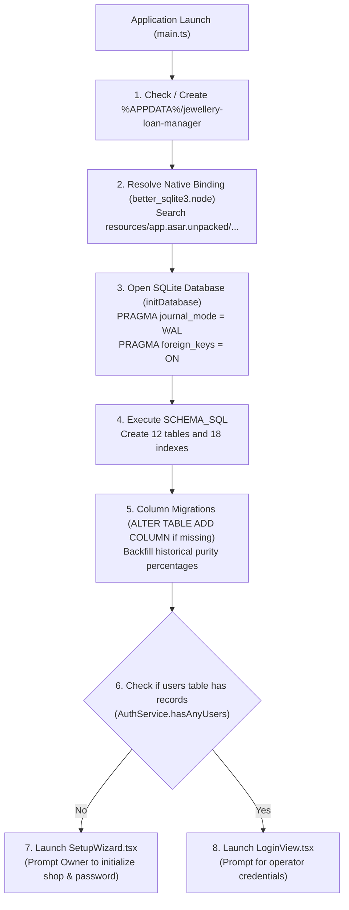

# Installation, Build, Packaging, & Runtime Guide — SwarnaRaksha Loan Manager

**Document Version:** 1.0.0  
**Target Platform:** Windows 10 / 11 (64-bit)  
**Runtime Toolchain:** Node.js v24.21.0, npm v11.19.0, Electron 34.2.0, Vite 6.4.3  
**Verified Source Files:** `package.json`, `vite.config.ts`, `tsconfig.json`, `tsconfig.electron.json`, `electron/main.ts`  

---

## 1. System Requirements & Prerequisites

### 1.1 Hardware Specifications
- **Processor:** x64-compatible dual-core processor (Intel Core i3 / AMD Ryzen 3 or higher).
- **RAM:** 4 GB minimum (8 GB recommended for simultaneous high-volume reporting).
- **Disk Storage:** 500 MB free storage for application runtime; additional storage for local database backups (typically 10 MB to 100 MB per year of transactions).
- **Display Resolution:** Minimum $1024 \times 700$; recommended $1400 \times 900$ or higher for multi-column collateral data grids.
- **Peripherals:** USB / Network A4 Printer for pledge memorandums, receipts, and day-end registers.

### 1.2 Software Prerequisites
- **Operating System:** Windows 10 (Build 19041+) or Windows 11 (64-bit).
- **Node.js:** v20.x LTS or v24.x LTS (Verified in production with Node `v24.21.0`).
- **Package Manager:** npm v10.x or v11.x (Verified with npm `11.19.0`).
- **C++ Native Build Dependencies (For Development Installs):**  
  `better-sqlite3` compiles against the target Node/Electron ABI. Windows machines require:
  - Python 3.10+
  - Visual Studio C++ Build Tools (with Desktop development with C++ workload) or pre-built binary wheels.

---

## 2. Dependency Inventory & Version Specifications

### 2.1 Runtime / Production Dependencies (`dependencies`)
Discovered in `package.json` (lines 47–52):

| Dependency | Declared Version | Category | Purpose in SwarnaRaksha |
| :--- | :--- | :--- | :--- |
| `better-sqlite3` | `^12.10.1` | Local Database Engine | Synchronous, embedded SQLite 3 engine running in WAL mode with native bindings. |
| `clsx` | `^2.1.1` | Utility | Conditional CSS class name concatenation for Tailwind styles. |
| `lucide-react` | `^1.16.0` | UI Icons | SVG icon suite for desktop navigation, badges, and operational action buttons. |
| `tailwind-merge` | `^3.0.2` | Utility | Merges overlapping Tailwind CSS utility classes without styling conflicts. |

### 2.2 Development Dependencies (`devDependencies`)
Discovered in `package.json` (lines 53–69):

| Dependency | Declared Version | Actual Installed Version | Purpose in Toolchain |
| :--- | :--- | :--- | :--- |
| `electron` | `^34.2.0` | `34.2.0` | Cross-platform desktop runtime container pairing Chromium with Node.js. |
| `electron-builder` | `^25.1.8` | `25.1.8` | Packages compiled JavaScript and assets into standalone Windows NSIS installers and portable directories. |
| `react` | `^19.0.0` | `19.0.0` | Frontend UI component rendering library. |
| `react-dom` | `^19.0.0` | `19.0.0` | React DOM bindings for Chromium browser rendering. |
| `typescript` | `^5.7.3` | `5.7.3` | Strongly typed JavaScript compiler enforcing compile-time safety across main and renderer. |
| `vite` | `^6.1.0` | `6.4.3` | Fast frontend bundler and local development HMR server. |
| `vitest` | `^3.0.5` | `3.2.7` | High-performance unit and integration test runner. |
| `tailwindcss` | `^3.4.17` | `3.4.17` | Utility-first CSS framework for modern responsive desktop layouts. |
| `postcss` | `^8.5.1` | `8.5.1` | Tool for transforming CSS with JavaScript plugins. |
| `autoprefixer` | `^10.4.20` | `10.4.20` | Parses CSS and adds vendor prefixes automatically. |
| `@types/better-sqlite3` | `^7.6.12` | `7.6.12` | TypeScript definitions for better-sqlite3 database bindings. |
| `@types/node` | `^22.13.1` | `22.13.1` | TypeScript definitions for Node.js standard library APIs. |
| `@types/react` | `^19.0.8` | `19.0.8` | TypeScript definitions for React core. |
| `@types/react-dom` | `^19.0.3` | `19.0.3` | TypeScript definitions for React DOM. |
| `@vitejs/plugin-react` | `^4.3.4` | `4.3.4` | Vite plugin enabling React Fast Refresh and JSX transformation. |

---

## 3. Installation & Setup Process

### Step 1: Clone or Extract Repository
```powershell
cd C:\Users\KAVYA\Desktop\swarna
```

### Step 2: Install Node Dependencies
```powershell
npm install
```
During installation, `better-sqlite3` automatically links or builds the native binary `better_sqlite3.node` matching your installed Node and Electron environments.

---

## 4. Development Launch Instructions

Running SwarnaRaksha in development requires two terminal instances running concurrently:

### Terminal 1: Launch Vite Frontend Dev Server
```powershell
npm run dev
```
- Starts the Vite development server on `http://localhost:5173`.
- Provides Hot Module Replacement (HMR) for instant UI updates.

### Terminal 2: Compile Electron Main Process & Launch App
```powershell
npm run dev:electron
```
- Runs `tsc -p tsconfig.electron.json` to compile TypeScript in `electron/` into `dist-electron/`.
- Launches the Electron runtime pointing to the local Vite development server (`process.env.VITE_DEV_SERVER_URL = http://localhost:5173`).

---

## 5. Automated Testing Execution

The test suite evaluates financial formulas, repayment waterfalls, ledger immutability, RBAC permissions, and database backup integrity:

```powershell
npm test
```

### Critical Execution Parameter: `--fileParallelism=false`
In `package.json`, the test script is configured as:
```json
"test": "vitest run --fileParallelism=false tests/"
```
> **Windows SQLite File Lock Note:**  
> On Windows operating systems, SQLite holds exclusive file locks on active database files (`.sqlite`). Running tests concurrently in parallel processes causes Windows `EBUSY: resource busy or locked` file-access errors during setup and teardown. `--fileParallelism=false` ensures tests run sequentially, achieving 100% test reliability.

---

## 6. Production Compilation & Packaging

### 6.1 Compiling Application Bundles
To compile both the React renderer and the Electron main process for production:
```powershell
npm run build
```
This script executes two sequential sub-tasks:
1. `npm run build:renderer` (`tsc -b && vite build`):
   - Compiles TypeScript components and bundles HTML, CSS, and JS into `dist/`.
   - Asset footprint: `dist/index.html` (~0.85 KB), `dist/assets/*.css` (~40 KB), `dist/assets/*.js` (~591 KB).
2. `npm run build:electron` (`tsc -p tsconfig.electron.json`):
   - Compiles main process files (`electron/*.ts`, `electron/services/*.ts`, `electron/database/*.ts`) into `dist-electron/`.

---

### 6.2 Packaging Windows Executable Packages

Packaging is orchestrated by `electron-builder` according to configuration blocks in `package.json` (lines 8–36):

```json
"build": {
  "appId": "com.swarnaraksha.jewelleryloanmanager",
  "productName": "SwarnaRaksha Loan Manager",
  "directories": {
    "output": "release"
  },
  "files": [
    "dist/**/*",
    "dist-electron/**/*",
    "package.json"
  ],
  "asarUnpack": [
    "**/node_modules/better-sqlite3/**/*"
  ],
  "win": {
    "target": [
      "nsis",
      "dir"
    ],
    "sign": "electron/build/sign.js"
  },
  "nsis": {
    "oneClick": false,
    "allowToChangeInstallationDirectory": true,
    "createDesktopShortcut": true,
    "createStartMenuShortcut": true,
    "shortcutName": "SwarnaRaksha Loan Manager"
  }
}
```

#### A. Generating Portable Unpacked Directory
To build an unpacked, portable application directory (for testing binary execution without running an installer):
```powershell
npm run dist:dir
```
- Outputs to `release/win-unpacked/`.
- Launchable directly via `release/win-unpacked/SwarnaRaksha Loan Manager.exe`.

#### B. Generating Windows NSIS Installer (`.exe`)
To generate a distributable Windows installer:
```powershell
npm run dist
```
- Creates `release/SwarnaRaksha Loan Manager Setup 1.0.0.exe`.
- Features: Custom installation directory selection, desktop shortcut creation, start menu shortcut, and automatic uninstallation registry entries.
- **ASAR Unpacking (`asarUnpack`):** Unpacks `better-sqlite3` native C++ binary bindings outside the read-only ASAR archive (`app.asar.unpacked/node_modules/better-sqlite3/build/Release/`), allowing direct operating system binary execution.

---

## 7. Database Initialization & First-Run Lifecycle

When the compiled application is launched on a clean machine:



---

## 8. Application Upgrades & Migration Safety

1. **Preserving Customer & Financial Data:**  
   The application database is stored in `%APPDATA%\jewellery-loan-manager\jewellery_vault.sqlite`. Running an updated NSIS installer overwrites only the application binaries in `Program Files`; it **never deletes or modifies user data stored in `%APPDATA%`**.
2. **Pre-Upgrade Backup Protocol:**  
   Before running any software update or new version installer:
   - Launch the current version.
   - Navigate to **Backup & Restore**.
   - Create a manual backup and copy the resulting `.sqlite` file onto an external USB flash drive.
3. **Automatic Schema Migration on Startup:**  
   When a new software version starts against an older database, `initDatabase()` in `electron/database/connection.ts` automatically applies non-destructive column additions and historical data backfills.
