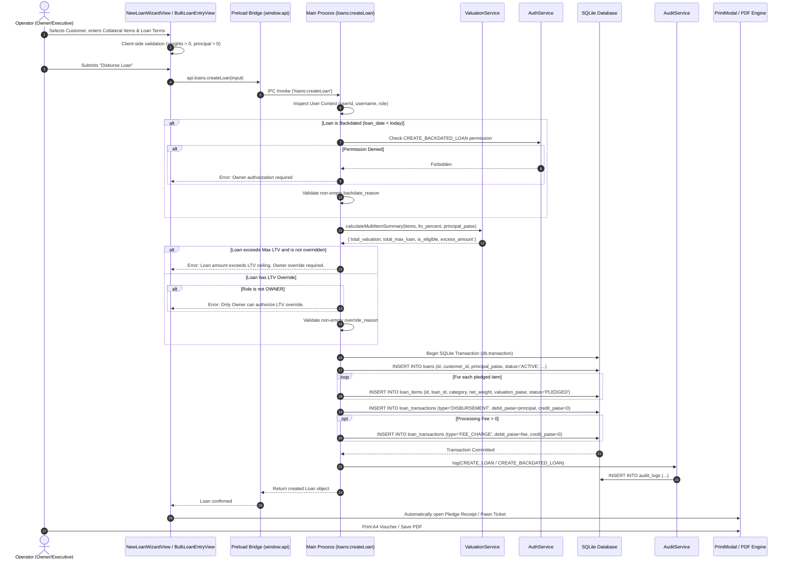
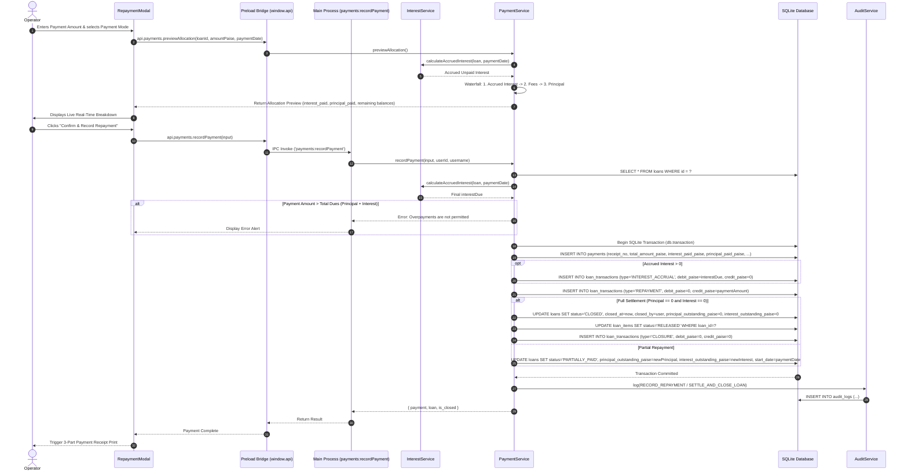

# SwarnaRaksha — Complete Technical & Architectural Documentation
## Jewellery Loan Vault / Jewellery Loan Management System

---

**Document Identifier:** `SR-DOC-2026-v1.0`  
**Application Title:** SwarnaRaksha — Jewellery Loan Vault Desktop Application  
**Package Identifier:** `com.swarnaraksha.jewelleryloanmanager` (Version 1.0.0)  
**Classification:** Enterprise Technical Reference, Architectural Blueprint, & User Operations Manual  
**Authoring Roles:** Senior Software Architect, Lead Financial Systems Analyst, Database Engineer, & Security Reviewer  
**Verification Date:** October 19, 2026  
**Operational Context:** 100% Offline Desktop (Windows 10/11 x64)  
**Source Repository:** `c:\Users\KAVYA\Desktop\swarna`  

---

## Table of Contents

1. [Executive Summary & Problem Domain](#1-executive-summary--problem-domain)
2. [Complete Feature & Module Inventory](#2-complete-feature--module-inventory)
3. [Technology Stack & Dependency Inventory](#3-technology-stack--dependency-inventory)
4. [System Architecture & Component Interaction](#4-system-architecture--component-interaction)
5. [Database Architecture, Schema Reference, & ERD](#5-database-architecture-schema-reference--erd)
6. [Financial Logic, Jewellery Valuation, & Mathematical Formulas](#6-financial-logic-jewellery-valuation--mathematical-formulas)
7. [APIs, IPC Channels, & Integration Reference](#7-apis-ipc-channels--integration-reference)
8. [Security, Privacy, Cryptography, & RBAC Governance](#8-security-privacy-cryptography--rbac-governance)
9. [Operational Metrics & Dashboard Indicators](#9-operational-metrics--dashboard-indicators)
10. [Measured Software & Engineering Metrics](#10-measured-software--engineering-metrics)
11. [End-to-End Operational Workflows](#11-end-to-end-operational-workflows)
12. [User Interface Guide & Screen Catalog](#12-user-interface-guide--screen-catalog)
13. [Installation, Build, Packaging, & Runtime Guide](#13-installation-build-packaging--runtime-guide)
14. [Testing & Quality Assurance Report](#14-testing--quality-assurance-report)
15. [Known Limitations, Architectural Risks, & Recommendations](#15-known-limitations-architectural-risks--recommendations)
16. [Glossary of Business & Technical Terminology](#16-glossary-of-business--technical-terminology)
17. [Source Code Evidence & Traceability Index](#17-source-code-evidence--traceability-index)

---

## 1. Executive Summary & Problem Domain

### 1.1 What is SwarnaRaksha?
**SwarnaRaksha** (*Sanskrit: "Gold Protection"*) is a production-grade, desktop-first, **100% offline Jewellery Loan Management Application** specifically designed for Indian retail jewellery stores, pawn brokers, indigenous bankers (*sahukars*), and Non-Banking Financial moneylenders providing credit against physical gold and silver collateral.

The application governs the entire lifecycle of jewellery-backed loans: from customer identity registration and precious metal appraisal to loan contract disbursement, dynamic daily/monthly interest accrual, prioritized repayment waterfall allocation, vault custody tracking, and final collateral release upon settlement.

### 1.2 The Problems SwarnaRaksha Solves
Traditional jewellery lending in India has historically relied on physical paper ledgers (*khatta-bahi*), loose pledge tickets, and error-prone generic spreadsheets. These manual approaches suffer from severe systemic vulnerabilities:

1. **Floating-Point Rounding Losses & Accounting Disputes:** Generic software using IEEE 754 floating-point numbers incurs fractional rounding discrepancies over multi-year compounding loans, causing compliance issues and customer disputes.
2. **Incorrect Interest Calculations on Partial Repayments:** Many lenders fail to amortize interest properly when borrowers make irregular partial payments. Without an automated waterfall allocation engine, lenders either overcharge borrowers (risking legal challenges) or undercharge interest (eroding margins).
3. **Purity & Valuation Errors:** Manual weight tare deductions (subtracting wax, lac, stones, or enamel) frequently lead to inaccurate net weights, resulting in over-lending against non-precious components.
4. **Data Loss & Disasters:** Paper ledgers and simple spreadsheets are vulnerable to fire, theft, hardware failure, or accidental deletion, with no automated integrity checks or hot backups.
5. **Customer Privacy & Aadhaar Non-Compliance:** Storing plaintext Aadhaar copies in unencrypted spreadsheets violates Indian data protection mandates.
6. **Cloud & Connectivity Dependency:** Most modern SaaS loan applications require high-speed internet. In rural or semi-urban pawn shops with intermittent power or connectivity, cloud dependency causes counter downtime.

SwarnaRaksha eliminates these challenges through an **air-gapped, zero-network, local desktop architecture** built on strict integer paise financial precision, hardware-speed embedded SQLite in Write-Ahead Logging (WAL) mode, AES-256-GCM field encryption, and automated hot backups.

---

## 2. Complete Feature & Module Inventory

Based on verified implementation across `src/views/`, `src/components/`, and `electron/services/`, SwarnaRaksha provides 18 fully implemented functional modules:

### 2.1 First-Run Setup & Initialization
- **Purpose:** Onboarding wizard for newly installed applications.
- **Primary Users:** Business Owner / Primary Administrator.
- **Screens:** `src/components/setup/SetupWizard.tsx`.
- **Inputs:** Business name, tagline, address, city, state, pincode, phone, email, GSTIN, pawn broker license number, default loan terms, master owner username and password.
- **Business Logic:** Checked via `AuthService.hasAnyUsers()`. If the `users` table is empty, renders the wizard. Creates the first owner with salted PBKDF2-SHA512 password hash, seeds default metal rates (`24K` to `14K` gold, `999` to `600` silver), initial custom categories, and default material types.
- **Database Tables:** `users`, `business_settings`, `metal_rates`, `custom_categories`, `material_types`.
- **Code Location:** `electron/services/authService.ts:43`, `electron/database/seed.ts`.

### 2.2 User Authentication & Session Security
- **Purpose:** Secure identity verification, role assignment, and inactivity auto-lock.
- **Primary Users:** All staff (Owner and Executive).
- **Screens:** `src/views/LoginView.tsx`.
- **Inputs:** Username, password.
- **Business Logic:** Constant-time password verification via `crypto.timingSafeEqual`. Dummy hash evaluation on non-existent usernames mitigates timing enumeration attacks. Tracks user activity heartbeat; locks session after 15 minutes of inactivity (`inactivity_timeout_minutes`).
- **Database Tables:** `users`, `audit_logs`.
- **Code Location:** `electron/services/authService.ts`, `src/context/AuthContext.tsx`.

### 2.3 Role-Based Access Control (RBAC) & User Management
- **Purpose:** User provisioning, status toggles, password resets, and granular permission overrides.
- **Primary Users:** Business Owner.
- **Screens:** `src/views/UsersManagementView.tsx`.
- **Inputs:** New user full name, username, password, role (`OWNER` or `EXECUTIVE`), permission checkboxes.
- **Business Logic:** Owner possesses all 19 permissions by default. Executive has counter operations (Pledging, Repayments, Customer registration) but is blocked from Aadhaar unmasking, rate changes, transaction reversals, and database restoration. Owner can grant custom granular overrides stored in `user_permissions`.
- **Database Tables:** `users`, `user_permissions`, `audit_logs`.
- **Code Location:** `electron/services/authService.ts:161-352`.

### 2.4 Customer Master Management
- **Purpose:** Borrower KYC profile registration, search, and demographic tracking.
- **Primary Users:** Owner, Executive.
- **Screens:** `src/views/CustomersView.tsx`, `src/views/CustomerProfileView.tsx`, `src/components/customers/QuickCustomerModal.tsx`.
- **Inputs:** Full name, mobile number, alternate phone, 12-digit Aadhaar number, street address, city, state, pincode, reputation notes.
- **Validation:** 10-digit phone, non-empty name and address. Aadhaar is encrypted via AES-256-GCM; plaintext last 4 digits (`aadhaar_last4`) are stored for rapid search and UI display.
- **Outputs:** Comprehensive customer profile detailing active loans, closed loans, dynamic total dues, pledged items in vault custody, and transaction history.
- **Database Tables:** `customers`, `loans`, `loan_items`, `payments`, `loan_transactions`.
- **Code Location:** `electron/services/customerService.ts`.

### 2.5 New Loan Wizard (Guided 10-Step Workflow)
- **Purpose:** Core loan origination and collateral booking workflow.
- **Primary Users:** Owner, Executive.
- **Screens:** `src/views/NewLoanWizardView.tsx`.
- **Inputs:** Customer selector, contract date, tenure months, interest rate %, interest period (`MONTHLY`/`YEARLY`/`DAILY`), interest method (`MONTHLY_SIMPLE`/`DAILY_SIMPLE`/`FLAT`), minimum interest days, grace period days, LTV ceiling %, collateral articles list (category, custom category, description, metal, purity, gross wt, stone wt, rate/g, allocated loan), disbursement mode, processing fee, backdate reason (if backdated).
- **Business Logic:** Real-time net weight calculation (`Gross - Stone`). LTV validation enforces $\text{Principal} \le \text{Max Loan Capacity}$; requires Owner override and reason if exceeded. Executes atomic transaction writing `loans`, `loan_items`, and `loan_transactions` (Disbursement debit).
- **Database Tables:** `loans`, `loan_items`, `loan_transactions`, `audit_logs`.
- **Code Location:** `electron/services/loanService.ts:54-319`.

### 2.6 High-Speed Bulk Loan Entry
- **Purpose:** Rapid spreadsheet-style data grid for entering loan backlogs.
- **Primary Users:** Owner, Executive.
- **Screens:** `src/views/BulkLoanEntryView.tsx`.
- **Inputs:** Customer selector, historical loan date, tenure months, aggregated material blocks (Gold / Silver, gross weight, stone weight, rate, loan amount).
- **Business Logic:** Allows multi-material consolidated entry with keyboard tab navigation. Validates LTV and backdating permissions; books loan in an atomic transaction.
- **Database Tables:** `loans`, `loan_items`, `loan_transactions`.
- **Code Location:** `src/views/BulkLoanEntryView.tsx`, `electron/services/loanService.ts`.

### 2.7 Loan Directory & Query Engine
- **Purpose:** Searchable catalog of all historical and active loan contracts.
- **Primary Users:** Owner, Executive.
- **Screens:** `src/views/LoansListView.tsx`.
- **Inputs:** Status filter (`ALL`, `ACTIVE`, `PARTIALLY_PAID`, `OVERDUE`, `CLOSED`, `CANCELLED`), customer ID, date ranges, text search.
- **Outputs:** Tabular directory with customer phone, principal disbursed, outstanding principal, dynamic accrued interest up to today, and total dues.
- **Database Tables:** `loans`, `customers`.
- **Code Location:** `electron/services/loanService.ts:349-438`.

### 2.8 Loan Details Command Center
- **Purpose:** Single-loan 360-degree management hub.
- **Primary Users:** Owner, Executive.
- **Screens:** `src/views/LoanDetailsView.tsx`.
- **Tabs:** Overview, Pledged Jewellery, Financial Ledger, Repayments History, Documents & Receipts, Activity Audit Log.
- **Actions:** Record repayment, print vouchers, execute financial transaction reversals (Owner only).
- **Database Tables:** `loans`, `loan_items`, `loan_transactions`, `payments`, `audit_logs`.
- **Code Location:** `src/views/LoanDetailsView.tsx`.

### 2.9 Repayment & Waterfall Allocation Engine
- **Purpose:** Receipting funds and applying prioritized amortization.
- **Primary Users:** Owner, Executive.
- **Screens:** `src/views/RepaymentModal.tsx`.
- **Inputs:** Loan selector, payment amount, payment date, payment mode (`CASH`, `UPI`, `BANK_TRANSFER`, `CHEQUE`), reference number, remarks.
- **Business Logic:** Computes dynamic accrued interest. Live allocation preview shows interest paid, principal paid, and remaining balances. Prevents overpayments. Writes payment voucher, interest accrual debit, and repayment credit. Advances `start_date` to payment date. If balance reaches zero, closes loan and sets collateral to `RELEASED`.
- **Database Tables:** `payments`, `loans`, `loan_items`, `loan_transactions`, `audit_logs`.
- **Code Location:** `electron/services/paymentService.ts`.

### 2.10 Double-Entry Financial Ledger
- **Purpose:** Chronological, immutable accounting journal for every loan account.
- **Primary Users:** Owner, Executive.
- **Screens:** Embedded in `LoanDetailsView.tsx` (Financial Ledger tab).
- **Transaction Types:** `DISBURSEMENT`, `INTEREST_ACCRUAL`, `REPAYMENT`, `FEE_CHARGE`, `PENALTY`, `REVERSAL`, `ADJUSTMENT`, `CLOSURE`.
- **Business Logic:** Every entry records debit, credit, running principal balance, and running interest balance. In-place deletion is prohibited; reversals write compensating entries (`is_reversal = 1`).
- **Database Tables:** `loan_transactions`.
- **Code Location:** `electron/services/ledgerService.ts`.

### 2.11 Counter Walk-In Valuation Calculator
- **Purpose:** Fast physical appraisal tool for counter walk-ins.
- **Primary Users:** Owner, Executive.
- **Screens:** `src/views/ValuationCalculatorView.tsx`.
- **Inputs:** Gross weight, stone tare weight, precious metal, purity/karat, market rate per gram, LTV %.
- **Outputs:** Net pure metal weight, appraised collateral valuation, max eligible loan, shop safety margin.
- **Database Tables:** Pure in-memory calculation (no database writes).
- **Code Location:** `electron/services/valuationService.ts`.

### 2.12 Metal Rates Management
- **Purpose:** Setting and tracking daily bullion market prices.
- **Primary Users:** Business Owner.
- **Screens:** `src/views/RatesManagementView.tsx`.
- **Inputs:** Material (`GOLD`/`SILVER`), purity designator, rate in paise per gram.
- **Business Logic:** Appends historical record with timestamp and author; synchronizes matching records in `material_types`.
- **Database Tables:** `metal_rates`, `material_types`, `audit_logs`.
- **Code Location:** `electron/services/rateService.ts`.

### 2.13 Custom Categories & Material Types Configuration
- **Purpose:** Defining custom jewellery article categories and metal purities.
- **Primary Users:** Business Owner.
- **Screens:** `src/views/SettingsView.tsx` (Articles & Metal Purity tabs).
- **Inputs:** Category name; material type name, base metal, exact purity %, karat/fineness, default rate.
- **Business Logic:** Case-insensitive deduplication, active/inactive toggles, pro-rata rate calculation.
- **Database Tables:** `custom_categories`, `material_types`, `audit_logs`.
- **Code Location:** `electron/services/categoryService.ts`, `electron/services/materialTypeService.ts`.

### 2.14 Daily Business Closing (End-of-Day EOD)
- **Purpose:** Reconciling daily cash drawer, digital receipts, disbursements, and cash flow.
- **Primary Users:** Business Owner / Shop Manager.
- **Screens:** `src/views/DailyClosingView.tsx`.
- **Inputs:** Business date.
- **Outputs:** Total disbursed, total collected, cash collected, UPI, bank, cheque, loans opened, loans closed, net cash flow (`Collected - Disbursed`). Commits snapshot to `daily_closings` table and prints register closing summary.
- **Database Tables:** `daily_closings`, `loans`, `payments`, `audit_logs`.
- **Code Location:** `electron/services/dailyClosingService.ts`.

### 2.15 Reporting & Analytics
- **Purpose:** Business intelligence, KPI tracking, and data export.
- **Primary Users:** Business Owner, Executive.
- **Screens:** `src/views/DashboardView.tsx`, `src/views/ReportsView.tsx`.
- **Outputs:** Real-time KPI cards (Active Loans, Outstanding Principal, Accrued Interest, Total Dues, Total Disbursed, Total Collected, Closed Loans, Overdue Loans, Due in 7/30 days, Pledged Gold/Silver Weights, Active Customers). CSV exports for Loans, Payments, Collateral, and Customers.
- **Database Tables:** Read-only queries across all operational tables.
- **Code Location:** `electron/services/reportService.ts`.

### 2.16 Offline Historical Loans CSV Import Engine
- **Purpose:** Bulk migration of historical loan portfolios from legacy software or Excel.
- **Primary Users:** Business Owner / Authorized Staff.
- **Screens:** `src/views/ImportHistoricalLoansView.tsx`.
- **Features:** Downloadable CSV template, RFC 4180 parsing with quotes and line breaks, header mapping suggestions, validation engine catching weight/date/format errors, Aadhaar privacy masking in preview, duplicate detection, mandatory pre-import database backup, atomic batch execution with rollback safety.
- **Database Tables:** `import_batches`, `loans`, `loan_items`, `customers`, `loan_transactions`, `backups`.
- **Code Location:** `electron/services/csvImportService.ts`.

### 2.17 Native Printing & PDF Generation Subsystem
- **Purpose:** Document previewing, thermal/A4 printing, and PDF exports.
- **Primary Users:** Owner, Executive.
- **Screens:** `src/components/print/PrintModal.tsx`.
- **Supported Documents:** Pawn Ticket / Pledge Voucher, 3-Part Payment Receipt, Loan Closure & Collateral Release Certificate, Customer Account Statement, Daily Register Closing Summary.
- **Features:** Content customizer toggles (stored in `localStorage`), A4 CSS print styles, headless Chromium `printToPDF` inside hidden Electron window.
- **Code Location:** `src/components/print/PrintModal.tsx`, `electron/main.ts:332-404`, `src/utils/printStyles.ts`.

### 2.18 Database Backup & Disaster Recovery
- **Purpose:** Protecting shop records against hardware failure or corruption.
- **Primary Users:** Owner, Executive (Backup creation); Owner only (Restore).
- **Screens:** `src/views/BackupRestoreView.tsx`.
- **Features:** Native hot backups via `db.backup()`, pre-backup and pre-restore `PRAGMA integrity_check`, automatic pruning (keeps last 7 automatic backups), password-verified restore with automatic pre-restore safety snapshot and journal cleanup.
- **Database Tables:** `backups`, `audit_logs`.
- **Code Location:** `electron/services/backupService.ts`.

---

## 3. Technology Stack & Dependency Inventory

Based on verifiable evidence in `package.json`, `package-lock.json`, and project configuration files:

| Technology | Version | Category | Purpose | How It Is Used in SwarnaRaksha | Source Evidence |
| :--- | :--- | :--- | :--- | :--- | :--- |
| **Electron** | `34.2.0` | Desktop Runtime | Application Container | Hosts Chromium renderer and privileged Node.js main process with isolated IPC bridge. | `package.json:60`, `electron/main.ts` |
| **Node.js** | `v24.21.0` *(Tested)* | Backend Runtime | Core Execution Engine | Executes main process services, filesystem I/O, native crypto, and database bindings. | Runtime verification (`node -v`) |
| **React** | `19.0.0` | UI Framework | Component View Layer | Powers the reactive single-page application frontend. | `package.json:63`, `src/main.tsx` |
| **React DOM** | `19.0.0` | UI DOM Bindings | DOM Rendering | Mounts React component tree into the desktop Chromium webview. | `package.json:64`, `src/main.tsx` |
| **TypeScript** | `5.7.3` | Language / Compiler | Type Safety | Enforces strict static type checking across main, renderer, and database models. | `package.json:66`, `tsconfig.json` |
| **SQLite 3** | Embedded | Database Engine | Local Persistence | Provides ACID-compliant local SQL storage operating in WAL mode. | Embedded via `better-sqlite3` |
| **better-sqlite3** | `12.10.1` | Database Driver | Native C++ Binding | High-speed, synchronous database query execution directly within Node.js main process. | `package.json:48`, `connection.ts` |
| **Tailwind CSS** | `3.4.17` | UI Styling | Styling Engine | Utility-first CSS classes for responsive layouts, modal overlays, and print styles. | `package.json:65`, `tailwind.config.js` |
| **Lucide React** | `1.16.0` | UI Assets | Iconography | High-resolution scalable vector icons for navigation, status badges, and buttons. | `package.json:50`, UI views |
| **clsx** | `2.1.1` | Utility | Class Management | Dynamic conditional CSS class construction. | `package.json:49` |
| **tailwind-merge** | `3.0.2` | Utility | Style Conflict Resolution | Safely merges conflicting Tailwind utility classes. | `package.json:51` |
| **Vite** | `6.4.3` *(Declared `^6.1.0`)* | Bundler & Dev Server | Build System | Fast compilation of React renderer; HMR development server. | `package.json:67`, `vite.config.ts` |
| **Vitest** | `3.2.7` *(Declared `^3.0.5`)* | Test Runner | Automated Testing | Executes 102 automated unit and integration tests with sequential file execution. | `package.json:68`, `tests/` |
| **Electron Builder**| `25.1.8` | Packaging Tool | Installer Generator | Builds Windows NSIS installer and unpacked portable executables. | `package.json:61`, `package.json:8-36` |
| **Node.js Crypto** | Native | Cryptography | Security Subsystem | Native PBKDF2-SHA512 password hashing and AES-256-GCM Aadhaar field encryption. | `electron/services/cryptoService.ts` |
| **PostCSS** | `8.5.1` | Build Pipeline | CSS Processor | Transforms Tailwind utility rules into compiled CSS. | `package.json:62`, `postcss.config.cjs` |
| **Autoprefixer** | `10.4.20` | Build Pipeline | CSS Compatibility | Automatically injects vendor prefixes for CSS compatibility. | `package.json:59` |

---

## 4. System Architecture & Component Interaction

### 4.1 High-Level Architecture Diagram

```mermaid
flowchart TD
    subgraph UI_Renderer ["Chromium Renderer Process (Sandboxed UI)"]
        ReactApp["React 19 SPA (TypeScript)"]
        UI_Context["AuthContext & User Session"]
        UI_Views["Views (Dashboard, Loans, Payments, Reports, etc.)"]
        UI_Print["PrintModal & Print Styles"]
        PreloadBridge["window.api (Electron Preload Bridge)"]
    end

    subgraph IPC_Boundary ["IPC Communication Boundary (contextBridge)"]
        IPC_Invoke["ipcRenderer.invoke()"]
        IPC_Handle["ipcMain.handle()"]
    end

    subgraph Electron_Main ["Electron Main Process (Node.js v24 Runtime)"]
        MainEntry["Main Entry Point (electron/main.ts)"]
        
        subgraph Services ["Application Business Services"]
            AuthSvc["AuthService (RBAC, PBKDF2)"]
            CustSvc["CustomerService (AES-256-GCM)"]
            LoanSvc["LoanService (Lifecycle & Terms)"]
            PaySvc["PaymentService (Waterfall Engine)"]
            ValSvc["ValuationService (Appraisal & LTV)"]
            IntSvc["InterestService (Accrual Engine)"]
            LedgSvc["LedgerService (Double-Entry Ledger)"]
            RateSvc["RateService (Metal Rates & Pro-Rata)"]
            CloseSvc["DailyClosingService (EOD Register)"]
            RepSvc["ReportService (KPIs & CSV Export)"]
            BckSvc["BackupService (Online Hot Backup)"]
            AudSvc["AuditService (Immutable Logging)"]
            CSVSvc["CSVImportService (Historical Import)"]
            CatSvc["CategoryService (Custom Categories)"]
            MatSvc["MaterialTypeService (Purity Config)"]
            SetSvc["SettingService (Shop Config & IDs)"]
        end

        subgraph PDF_Engine ["Headless Print Engine"]
            HiddenWin["Hidden BrowserWindow (A4 printToPDF)"]
        end
    end

    subgraph Data_Layer ["Persistent Storage Layer (Local Disk)"]
        SQLiteDB[("SQLite 3 Database (WAL Mode)\njewellery_vault.sqlite")]
        MasterKeyFile[(".vault_master.key\n(AES-256 Master Key)")]
        BackupsFolder[("Local Backup Archive\n*.sqlite")]
        AppLogFile[("app.log\n(Runtime Error Log)")]
    end

    %% Connections
    ReactApp --> PreloadBridge
    PreloadBridge --> IPC_Invoke
    IPC_Invoke --> IPC_Handle
    IPC_Handle --> MainEntry
    MainEntry --> Services
    MainEntry --> PDF_Engine
    Services --> SQLiteDB
    CustSvc -.-> MasterKeyFile
    BckSvc -.-> BackupsFolder
    MainEntry -.-> AppLogFile
```



---

### 4.2 Loan Creation Sequence Diagram



---

### 4.3 Repayment & Waterfall Allocation Sequence Diagram



---

## 5. Database Architecture, Schema Reference, & ERD

### 5.1 Storage Layout & Performance Flags
- **Database Engine:** SQLite 3 via `better-sqlite3` v12.10.1
- **File Location:** `%APPDATA%\jewellery-loan-manager\jewellery_vault.sqlite`
- **Journals:** `jewellery_vault.sqlite-wal` (Write-Ahead Log), `jewellery_vault.sqlite-shm` (Shared Memory Map)
- **Active Flags:**
  ```sql
  PRAGMA journal_mode = WAL;
  PRAGMA foreign_keys = ON;
  PRAGMA synchronous = NORMAL;
  ```

### 5.2 Complete Relational Schema Table Catalog

The application maintains 12 relational tables:

1. **`users`:** Operator credentials, role (`OWNER`, `EXECUTIVE`), PBKDF2 hash, and salt.
2. **`user_permissions`:** Granular permission overrides (`user_id`, `permission`, `is_granted`).
3. **`business_settings`:** Key-value configuration storage (`key TEXT PRIMARY KEY, value TEXT NOT NULL`).
4. **`metal_rates`:** Historical log of gold/silver prices by purity and effective date (`rate_per_gram_paise`).
5. **`customers`:** Borrower profiles with encrypted Aadhaar (`aadhaar_encrypted`, `aadhaar_iv`, `aadhaar_tag`), plaintext `aadhaar_last4`, and demographics.
6. **`loans`:** Principal loan contracts, financial balances (`principal_paise`, `principal_outstanding_paise`, `interest_outstanding_paise`), interest terms, LTV %, status (`ACTIVE`, `PARTIALLY_PAID`, `OVERDUE`, `CLOSED`), and override/backdate reasons.
7. **`custom_categories`:** User-defined jewellery article categories (`name TEXT UNIQUE COLLATE NOCASE`).
8. **`material_types`:** Karatage and fineness purity definitions (`purity_percent`, `karat_or_fineness`, default rate).
9. **`loan_items`:** Pledged collateral ornaments (`gross_weight_grams`, `stone_weight_grams`, `net_weight_grams`, `rate_per_gram_paise`, `valuation_paise`, custody `status`).
10. **`loan_transactions`:** Double-entry financial ledger (`debit_paise`, `credit_paise`, running balances, reversal pointers).
11. **`payments`:** Receipt vouchers for incoming repayments (`receipt_no`, breakdown by interest/principal).
12. **`daily_closings`:** Day-end register closing tallies by payment mode (`cash`, `upi`, `bank`, `cheque`).
13. **`audit_logs`:** Immutable activity audit trail capturing operator, action, module, and before/after states.
14. **`backups`:** Metadata register of local database backups.
15. **`import_batches`:** Session log tracking historical loan CSV migration batches.

*(For detailed column definitions, data types, and index definitions, refer to [DATABASE_DOCUMENTATION.md](file:///c:/Users/KAVYA/Desktop/swarna/docs/DATABASE_DOCUMENTATION.md)).*

---

## 6. Financial Logic, Jewellery Valuation, & Mathematical Formulas

*(Full mathematical equations and proofs are detailed in [FINANCIAL_LOGIC_AND_FORMULAS.md](file:///c:/Users/KAVYA/Desktop/swarna/docs/FINANCIAL_LOGIC_AND_FORMULAS.md)).*

### 6.1 Jewellery Weight Formula
$$\text{Net Weight (grams)} = \max\left(0, \text{round}(\text{Gross Weight} - \text{Stone Weight}, 3)\right)$$
- Precision: 3 decimal places (`0.001g` = 1 milligram accuracy).
- Validation: Gross $> 0$, Stone $\ge 0$, Stone $<$ Gross.

### 6.2 Bullion Purity Conversions
- **Gold Purity Percentage:**
  $$\text{Purity (\%)} = \text{round}\left(\frac{\text{Karat}}{24} \times 100, 2\right)$$
  *(e.g. 24K = 100.00%, 22K = 91.67%, 18K = 75.00%, 14K = 58.33%)*
- **Silver Purity Percentage:**
  $$\text{Purity (\%)} = \text{round}\left(\frac{\text{Fineness}}{1000} \times 100, 2\right) = \text{round}\left(\frac{\text{Fineness}}{10}, 2\right)$$
  *(e.g. 999 = 99.90%, 925 = 92.50%, 800 = 80.00%, 700 = 70.00%)*

### 6.3 Jewellery Valuation Equation
$$\text{Valuation (paise)} = \text{round}\left(\text{Net Weight (grams)} \times \text{Rate per Gram (paise)}\right)$$

#### Pro-Rata Benchmark Fallback:
If an unlisted purity is entered (e.g. 21K gold), the system calculates pro-rata from the 24K pure gold benchmark:
$$\text{Pro-Rata Rate} = \text{round}\left(\text{Benchmark Rate (24K)} \times \frac{\text{Purity \%}}{100}\right)$$

### 6.4 Loan-to-Value (LTV) Capacity
$$\text{Maximum Eligible Loan} = \text{round}\left(\text{Total Valuation (paise)} \times \frac{\text{LTV \%}}{100}\right)$$
$$\text{Available Margin} = \max\left(0, \text{Total Valuation} - \text{Requested Loan}\right)$$

### 6.5 Dynamic Interest Accrual Formulas
- **Elapsed Days:**
  $$\text{Actual Elapsed Days} = \max\left(0, \left\lfloor\frac{T_{\text{as\_of}} - T_{\text{start}}}{86,400,000}\right\rfloor\right)$$
- **Minimum Interest Lock Days (Default 15 Days):**
  $$\text{Billable Days} = \begin{cases} 
  0 & \text{if Actual Elapsed Days} = 0 \\
  \max(\text{Actual Elapsed Days}, \text{Min Interest Days}) & \text{if Actual Elapsed Days} > 0 
  \end{cases}$$
- **Monthly Simple Interest Calculation (`interest_period = 'MONTHLY'`):**
  $$\text{Daily Rate} = \frac{\text{Rate \%}}{30 \times 100}$$
  $$\text{Accrued Interest (paise)} = \text{Carried Unpaid Interest} + \text{round}\left(\text{Principal Outstanding} \times \text{Daily Rate} \times \text{Billable Days}\right)$$
- **Flat Interest Calculation (`interest_method = 'FLAT'`):**
  $$\text{Accrued Interest (paise)} = \text{round}\left(\text{Principal Outstanding} \times \frac{\text{Rate \%}}{100}\right)$$

### 6.6 Repayment Waterfall Amortization
Incoming funds ($P$) are allocated in strict sequence:
1. **Tier 1 (Accrued Interest):** $\text{Interest Paid} = \min(P, \text{Total Interest Due})$
2. **Tier 2 (Fees & Charges):** $\text{Fees Paid} = \min(P - \text{Interest Paid}, \text{Fees Due})$
3. **Tier 3 (Principal Reduction):** $\text{Principal Paid} = \min(P - \text{Interest Paid} - \text{Fees Paid}, \text{Principal Outstanding})$

$$\text{New Principal Outstanding} = \text{Principal Outstanding} - \text{Principal Paid}$$
$$\text{New Interest Outstanding} = \text{Total Interest Due} - \text{Interest Paid}$$

> **Key Architectural Behavior:** When a partial payment reduces principal, the loan's `start_date` is updated to the `payment_date`. Future interest calculates elapsed days starting from this new reference date on the reduced principal balance.

---

## 7. APIs, IPC Channels, & Integration Reference

SwarnaRaksha exposes zero HTTP endpoints. All interaction is conducted via **54 IPC channels** across 17 functional modules exposed in `electron/preload.ts`:

- `auth:*` (11 channels): Login, logout, user creation, password reset, permission overrides, inactivity heartbeat.
- `customers:*` (6 channels): Create, update, get by ID, unmask Aadhaar (Owner-only), search, profile view.
- `rates:*` (2 channels): Get latest metal rates, update daily rates (Owner-only).
- `categories:*` (4 channels): Get, create, update, and toggle custom article categories.
- `materialTypes:*` (4 channels): Get, create, update, and toggle precious metal purities.
- `valuation:*` (2 channels): Calculate single-item valuation and multi-item aggregated LTV.
- `interest:*` (1 channel): Calculate dynamic accrued interest.
- `loans:*` (4 channels): Create loan, get loan by ID, query loans with filters, refresh overdue statuses.
- `payments:*` (3 channels): Preview waterfall allocation, record repayment, get payments by loan ID.
- `ledger:*` (2 channels): Get chronological loan ledger, execute compensating reversal (Owner-only).
- `dailyClosing:*` (2 channels): Get day-end summary, commit daily register closing.
- `reports:*` (2 channels): Real-time dashboard KPI metrics, export CSV reports.
- `settings:*` (2 channels): Get shop settings, update business settings (Owner-only).
- `backups:*` (5 channels): Create hot backup, restore backup (Owner-only), list backups, OS directory/file pickers.
- `csv:*` (7 channels): Template generation, file selection, RFC 4180 parsing, validation, batch import, history, error CSV.
- `audit:*` (1 channel): Paginated query of immutable security logs (Owner-only).
- `system:*` (4 channels): Demo seed, native print dialog, save file dialog, native Chromium `downloadPDF`.

*(For complete request/response schemas and permission requirements for all channels, see [API_AND_INTEGRATION_REFERENCE.md](file:///c:/Users/KAVYA/Desktop/swarna/docs/API_AND_INTEGRATION_REFERENCE.md)).*

---

## 8. Security, Privacy, Cryptography, & RBAC Governance

*(For comprehensive security models and threat evaluations, see [SECURITY_AND_DATA_SAFETY.md](file:///c:/Users/KAVYA/Desktop/swarna/docs/SECURITY_AND_DATA_SAFETY.md)).*

### 8.1 Cryptographic Safeguards
1. **Password Hashing:** PBKDF2 with SHA-512, 100,000 iterations, and unique 16-byte cryptographically secure random salts.
2. **Timing-Safe Comparison:** `crypto.timingSafeEqual` prevents side-channel timing analysis.
3. **Aadhaar Encryption at Rest:** Encrypted with **AES-256-GCM** using unique 12-byte IVs and 16-byte authentication tags. Stored under restricted `.vault_master.key`.
4. **Masking:** Default display is masked (`XXXX XXXX 1234`). Decryption is restricted strictly to `OWNER` and logged to `audit_logs` (`VIEW_SENSITIVE_AADHAAR`).

### 8.2 Electron Container Security
- `contextIsolation: true`
- `nodeIntegration: false`
- `setWindowOpenHandler: deny` (Prevents popups and child windows)
- `will-navigate: preventDefault()` (Blocks navigation outside local application)
- `--disable-gpu-shader-disk-cache` (Prevents Windows `%APPDATA%\GPUCache` lock errors)

### 8.3 RBAC Permissions
The system governs 19 distinct operational permissions. Sensitive operations (`VIEW_FULL_AADHAAR`, `OVERRIDE_LTV`, `REVERSE_TRANSACTION`, `RESTORE_DATABASE`, `MANAGE_USERS`) are restricted exclusively to the `OWNER` role.

---

## 9. Operational Metrics & Dashboard Indicators

The Dashboard and managerial reports compute real-time operational indicators:

| Metric | Definition | Mathematical Query / Logic | Inclusion Rules | Source Evidence |
| :--- | :--- | :--- | :--- | :--- |
| **Active Loans** | Count of performing and overdue pledge contracts | `COUNT(CASE WHEN status IN ('ACTIVE', 'PARTIALLY_PAID', 'OVERDUE') THEN 1 END)` | Excludes `CLOSED`, `DRAFT`, `CANCELLED` | `reportService.ts:16-17` |
| **Principal Outstanding** | Total unpaid principal capital currently deployed | `SUM(principal_outstanding_paise)` | `status IN ('ACTIVE', 'PARTIALLY_PAID', 'OVERDUE')` | `reportService.ts:19` |
| **Accrued Unpaid Interest**| Dynamic unposted interest earned up to today | $\sum \text{InterestService.calculateAccruedInterest}(L, \text{today})$ | Computed dynamically across all active loans | `reportService.ts:33-37` |
| **Total Outstanding Dues** | Total debt owed by all active borrowers | $\text{Principal Outstanding} + \text{Accrued Interest} + \text{Other Charges}$ | Includes pending principal, interest, and charges | `reportService.ts:41` |
| **Total Capital Disbursed**| Historical gross loan capital issued since inception | `SUM(principal_paise)` | All loans in system | `reportService.ts:21` |
| **Total Repayments** | Gross funds collected across all channels | `SUM(total_amount_paise)` from `payments` | All payment vouchers | `reportService.ts:45` |
| **Closed Loans** | Total loan contracts fully settled | `COUNT(*) WHERE status = 'CLOSED'` | Fully amortized loans | `reportService.ts:18` |
| **Overdue Loans** | Loans past maturity and grace period | `COUNT(*) WHERE status = 'OVERDUE'` | Past due date + grace days | `reportService.ts:17` |
| **Loans Due Today** | Contracts maturing on current calendar date | `COUNT(*) WHERE due_date = today AND status IN ('ACTIVE', 'PARTIALLY_PAID')` | Maturing today | `reportService.ts:22` |
| **Loans Due in 7 Days** | Contracts maturing within next 7 days | `COUNT(*) WHERE due_date > today AND due_date <= date(today, '+7 days')` | Upcoming 7-day maturity | `reportService.ts:23` |
| **Loans Due in 30 Days** | Contracts maturing within next 30 days | `COUNT(*) WHERE due_date > today AND due_date <= date(today, '+30 days')` | Upcoming 30-day maturity | `reportService.ts:24` |
| **Total Gold in Vault** | Net weight of pledged gold held in vault custody | `SUM(net_weight_grams) WHERE material = 'GOLD' AND status = 'PLEDGED'` | Excludes released ornaments | `reportService.ts:51` |
| **Total Silver in Vault** | Net weight of pledged silver held in vault custody | `SUM(net_weight_grams) WHERE material = 'SILVER' AND status = 'PLEDGED'` | Excludes released silver | `reportService.ts:52` |
| **Active Customers** | Distinct borrowers with currently active loans | `COUNT(DISTINCT customer_id) WHERE status IN ('ACTIVE', 'PARTIALLY_PAID', 'OVERDUE')`| Customers with active exposure | `reportService.ts:59-62` |

---

## 10. Measured Software & Engineering Metrics

Measured via static code analysis and live build executions:

- **Source Code Language:** TypeScript (100% strict type checking)
- **Total TypeScript Files:** **76 files** across `electron/`, `src/`, `tests/`
- **Total Lines of Source Code (LOC):** **19,279 lines**
  - Presentation Views (`src/views/`): 18 files, 7,463 LOC
  - Backend Services (`electron/services/`): 17 files, 4,049 LOC
  - Automated Tests (`tests/`): 13 files, 2,116 LOC
  - Print Subsystem (`src/components/print/`): 1 file, 1,367 LOC
  - Electron Main & Preload (`electron/`): 3 files, 819 LOC
  - Database Layer (`electron/database/`): 3 files, 649 LOC
  - Utilities (`src/utils/`): 7 files, 629 LOC
  - Setup & Layout (`src/components/`): 8 files, 1,183 LOC
  - Type Definitions & Context: 2 files, 393 LOC
  - Entry Points: 4 files, 611 LOC
- **Production Dependencies:** 4 (`better-sqlite3`, `clsx`, `lucide-react`, `tailwind-merge`)
- **Development Dependencies:** 15 packages
- **TypeScript Compilation:** 0 errors (`npm run build`)
- **Vite Bundled Output:** `dist/index.html` (0.85 KB), `dist/assets/index-*.css` (40.23 KB), `dist/assets/index-*.js` (591.11 KB)
- **Automated Tests:** 23 test suites executed, **102 tests passed, 0 failures** (Duration: 8.31s)

---

## 11. End-to-End Operational Workflows

SwarnaRaksha provides guided, standardized workflows for counter operations:

1. **Workflow 1 — First-Time Initialization:** Setup wizard creates shop identity, configures numbering sequences, seeds metal rates, and sets master owner credentials.
2. **Workflow 2 — Customer Registration:** Captures customer demographics, validates phone, encrypts 12-digit Aadhaar via AES-256-GCM, and creates `CUST-NNNNNN`.
3. **Workflow 3 — Booking a New Loan (Wizard):** Customer selection, multi-item collateral valuation (`Net = Gross - Stone`), LTV evaluation, interest terms, disbursement, and automated Pawn Ticket voucher printing.
4. **Workflow 4 — Booking a Backdated Loan:** Permits historical disbursement date; requires Owner authority or `CREATE_BACKDATED_LOAN` permission plus mandatory `backdate_reason`. Accrues interest from historical date while logging actual creation timestamp.
5. **Workflow 5 — Bulk Loan Entry:** High-speed keyboard data grid for migrating loan backlogs with multi-commodity collateral.
6. **Workflow 6 — Counter Walk-In Appraisal:** In-memory valuation calculator providing instant appraisal and LTV limits without database writes.
7. **Workflow 7 — Repayment Processing:** Waterfall allocation settles accrued interest first, fees second, and principal third. Advances interest start date to payment date; prints 3-part receipt.
8. **Workflow 8 — Full Settlement & Collateral Release:** Sets balances to 0, marks loan `CLOSED`, changes pledged items to `RELEASED`, writes closure ledger entry, and prints Collateral Release Certificate.
9. **Workflow 9 — Financial Reversal:** Owner-only compensating reversal entry (`is_reversal = 1`) with mandatory audit reason.
10. **Workflow 10 — Day-End Closing & Reconciliation:** Reconciles cash drawer, UPI, and bank collections; commits daily register snapshot; prints A4 summary.
11. **Workflow 11 — Historical CSV Import:** Parses RFC 4180 CSV, validates rows, takes pre-import safety backup, groups multi-material items, and imports loans atomically.
12. **Workflow 12 — Backup & Disaster Recovery:** Native SQLite hot backup (`db.backup()`) with `PRAGMA integrity_check` verification; password-authorized restore with automatic pre-restore safety checkpoint.

*(Step-by-step instructions with screenshots and operational guidance are documented in [USER_GUIDE.md](file:///c:/Users/KAVYA/Desktop/swarna/docs/USER_GUIDE.md)).*

---

## 12. User Interface Guide & Screen Catalog

The application features a clean, professional, high-contrast user interface styled with Tailwind CSS (`slate-900` dark sidebar, `slate-50` clean content workspace, and `amber-500` jewellery gold branding):

- **Sidebar Navigation:** Collapsible navigation bar providing single-click routing across all 17 views with role-sensitive item visibility.
- **Topbar:** Houses Global Quick Action buttons (`+ New Loan`, `+ New Customer`, `Record Repayment`), real-time universal search (searches loans and customers simultaneously), and active user profile badge.
- **Dashboard (`DashboardView`):** Operational cockpit featuring 10 real-time KPI tiles, upcoming maturity alerts (Due Today, Due in 7 Days, Due in 30 Days), vault bullion summary, and recent audit activity feed.
- **Customer Directory & Profile (`CustomersView`, `CustomerProfileView`):** Paginated directory with instant phone/Aadhaar filtering. Customer profile displays active exposure, pledged ornaments, payment vouchers, and account statements.
- **New Loan Wizard (`NewLoanWizardView`):** 10-step wizard featuring inline customer registration, dynamic net weight calculation, LTV compliance indicators, override authorization modals, and voucher generation.
- **Bulk Loan Data Grid (`BulkLoanEntryView`):** Spreadsheet-style keyboard grid designed for rapid backlog entry.
- **Loan Details Hub (`LoanDetailsView`):** Complete loan command center with sub-tabs for Collateral Articles, Financial Ledger, Payment History, Printable Documents, and Audit Logs.
- **Repayment Waterfall Modal (`RepaymentModal`):** Real-time interactive allocation preview updating instantly as cashier types payment amounts.
- **Print & PDF Modal (`PrintModal`):** Document previewer with receipt section customization toggles (logos, disclaimers, rate displays) and direct native PDF export.

---

## 13. Installation, Build, Packaging, & Runtime Guide

*(For exact command lines, packaging configurations, and deployment steps, see [INSTALLATION_AND_BUILD_GUIDE.md](file:///c:/Users/KAVYA/Desktop/swarna/docs/INSTALLATION_AND_BUILD_GUIDE.md)).*

### 13.1 Quick Commands
- **Install Dependencies:** `npm install`
- **Development Mode:** `npm run dev` (Terminal 1) + `npm run dev:electron` (Terminal 2)
- **Run Tests:** `npm test` (`vitest run --fileParallelism=false tests/`)
- **Production Build:** `npm run build` (`npm run build:renderer && npm run build:electron`)
- **Build Portable Directory:** `npm run dist:dir` (Outputs to `release/win-unpacked/`)
- **Build Windows Installer:** `npm run dist` (Generates `release/SwarnaRaksha Loan Manager Setup 1.0.0.exe`)

---

## 14. Testing & Quality Assurance Report

The application was tested across 13 test suites evaluating financial calculations, repayment waterfalls, ledger immutability, RBAC permissions, and database backup integrity:

- **Vitest Framework:** v3.2.7
- **Test Results:** **102 tests executed, 102 passed (100% pass rate)**
- **Verification Highlights:**
  - Net weight rounding to 3 decimal places verified.
  - Multi-item valuation and LTV capacity ceiling verified.
  - Monthly simple interest and 15-day minimum lock period verified.
  - Prioritized repayment waterfall (Interest $\to$ Fees $\to$ Principal) verified.
  - Ledger immutability and compensating reversals verified.
  - Salted PBKDF2-SHA512 password verification and timing-safe checks verified.
  - Native SQLite hot backups and `PRAGMA integrity_check` verified.
  - Offline historical CSV RFC 4180 parsing and multi-material row grouping verified.

*(See [TESTING_AND_QUALITY_REPORT.md](file:///c:/Users/KAVYA/Desktop/swarna/docs/TESTING_AND_QUALITY_REPORT.md) for full execution logs).*

---

## 15. Known Limitations, Architectural Risks, & Recommendations

*(Detailed risk evaluations and code recommendations are cataloged in [KNOWN_LIMITATIONS_AND_RECOMMENDATIONS.md](file:///c:/Users/KAVYA/Desktop/swarna/docs/KNOWN_LIMITATIONS_AND_RECOMMENDATIONS.md)).*

### Summary of Discovered Items:
1. **Master Encryption Key Storage (`HIGH`):** `.vault_master.key` is stored in `%APPDATA%` with filesystem permissions `0o600`. Recommended: Migrate to Windows DPAPI via Electron's `safeStorage` API.
2. **Transaction Reversal Balance Synchronization (`HIGH`):** Reversing a payment inserts an offsetting ledger transaction but does not automatically modify `loans.principal_outstanding_paise`. Recommended: Atomically recalculate and update `loans` table balances upon reversal.
3. **Single-Workstation SQLite Concurrency (`MEDIUM`):** Embedded SQLite cannot safely coordinate concurrent multi-terminal writes across a local area network. Recommended: Retain SQLite for single-terminal stores; introduce client-server mode (e.g. PostgreSQL) for multi-counter stores.
4. **Database Encryption at Rest (`MEDIUM`):** Aadhaar is encrypted at field level, but the `.sqlite` file itself is unencrypted. Recommended: Implement SQLCipher for transparent full-database encryption.
5. **UI Formula Discrepancy in Total Dues (`LOW`):** `LoanDetailsView.tsx` omits `other_charges_paise` while Dashboard and Loans List include it. Recommended: Standardize `total_due_paise` calculation across all views via a shared utility function.
6. **Frontend Minified Bundle Size (`LOW`):** Vite generates a 591 KB monolithic JavaScript chunk. Recommended: Implement `React.lazy()` code-splitting on heavy administrative views.

---

## 16. Glossary of Business & Technical Terminology

- **Aadhaar:** 12-digit biometric identity number issued by UIDAI in India. Regulated by privacy mandates requiring encryption at rest and default masking (`XXXX XXXX 1234`).
- **Allocated Loan:** The specific portion of total principal disbursed that is secured against an individual pledged jewellery ornament.
- **ASAR (Atom Shell Archive):** Electron's archive format bundling application source code. Native C++ binaries (`better-sqlite3`) must be unpacked (`asarUnpack`) to allow operating system execution.
- **Backdated Loan:** A loan record created with a historical business date preceding the system entry timestamp, preserving true contract interest terms while maintaining audit traceability.
- **Bullion:** Precious metals in bulk form (gold and silver) valued by weight and purity rather than artistic craftsmanship.
- **Caratage / Karat (K):** Unit of gold purity expressing parts out of 24 (e.g., 24K = 99.9%+, 22K = 91.67%, 18K = 75.00%).
- **Compensating Reversal:** An accounting transaction that negates an erroneous entry by swapping debits and credits, preserving immutable chronological ledger history.
- **Double-Entry Ledger:** Accounting method where every financial transaction records balancing debit and credit entries.
- **Gross Weight:** Total physical weight of an ornament as measured on a scale, including precious metal, gemstones, beads, lac, wax, and enamel.
- **LTV (Loan-To-Value):** Regulatory or shop ceiling limiting the maximum loan amount disbursed relative to the appraised collateral valuation (typically 75% under Indian moneylending standards).
- **Millesimal Fineness:** Unit of precious metal purity expressing parts per thousand (e.g., Silver 999 = 99.9%, Silver 925 = 92.5% sterling silver).
- **Minimum Interest Days:** Contractual lock period (default 15 days) charging minimum interest even if the borrower settles the loan within fewer days.
- **Net Weight:** The pure precious metal weight eligible for valuation, calculated as $\text{Gross Weight} - \text{Stone Tare Weight}$.
- **Paise:** Smallest Indian currency unit (1 Rupee = 100 paise). Storing currency in integer paise prevents floating-point rounding discrepancies.
- **Pawn Ticket / Pledge Memorandum:** Formal legal contract voucher issued to the borrower detailing pledged collateral, loan terms, and pawn broker conditions.
- **PBKDF2-SHA512:** Cryptographic password derivation function applying 100,000 hashing rounds with salt to resist brute-force cracking.
- **Stone Tare Weight:** The estimated or certified weight of non-precious components (diamonds, pearls, wax, lac, synthetic stones) deducted from gross weight.
- **WAL (Write-Ahead Logging):** SQLite database journaling mode writing modifications to a separate log file, enabling high-concurrency concurrent reads without locking writes.
- **Waterfall Allocation:** Prioritized sequence of applying loan repayments: 1. Accrued Unpaid Interest, 2. Pending Fees & Charges, 3. Principal Reduction.

---

## 17. Source Code Evidence & Traceability Index

Every claim in this documentation is traceable to verified source code in the repository:

| Architectural Component | Primary Source File | Key Functions / Symbols |
| :--- | :--- | :--- |
| **Electron Main & Lifecycle** | `electron/main.ts` | `createWindow()`, `registerIpcHandlers()`, `downloadPDF()` |
| **Preload IPC Contract** | `electron/preload.ts` | `electronApi`, `contextBridge.exposeInMainWorld('api', ...)` |
| **SQLite Connection & Schema**| `electron/database/connection.ts` | `initDatabase()`, `getDatabasePath()`, WAL PRAGMAs, column migrations |
| **Database Schema DDL** | `electron/database/schema.ts` | `SCHEMA_SQL` (12 tables, 18 indexes) |
| **Database Seed Bootstrapper** | `electron/database/seed.ts` | `seedDemoData()`, default owner/worker creation |
| **Cryptographic Subsystem** | `electron/services/cryptoService.ts` | `hashPassword()`, `verifyPassword()`, `encryptAadhaar()`, `decryptAadhaar()` |
| **Authentication & RBAC** | `electron/services/authService.ts` | `login()`, `createUser()`, `PERMISSIONS`, `getUserPermissions()` |
| **Customer Management** | `electron/services/customerService.ts` | `createCustomer()`, `getUnmaskedAadhaar()`, `searchCustomers()`, `getCustomerProfile()` |
| **Loan Origination Engine** | `electron/services/loanService.ts` | `createLoan()`, `getLoans()`, `refreshOverdueStatuses()` |
| **Repayment Waterfall Engine** | `electron/services/paymentService.ts` | `previewAllocation()`, `recordPayment()` |
| **Interest Accrual Engine** | `electron/services/interestService.ts` | `calculateAccruedInterest()`, minimum lock days enforcement |
| **Valuation & LTV Engine** | `electron/services/valuationService.ts` | `calculateItemValuation()`, `calculateMultiItemSummary()` |
| **Double-Entry Ledger** | `electron/services/ledgerService.ts` | `getLedgerByLoanId()`, `reverseTransaction()` |
| **Metal Rates & Purity** | `electron/services/rateService.ts` | `getLatestRates()`, `getApplicableRate()`, pro-rata benchmark fallback |
| **Material Types Master** | `electron/services/materialTypeService.ts`| `getMaterialTypes()`, `findMaterialType()` |
| **Custom Article Categories** | `electron/services/categoryService.ts` | `createCustomCategory()`, case-insensitive lookup |
| **Day-End Closing (EOD)** | `electron/services/dailyClosingService.ts`| `getDailySummary()`, `commitDailyClosing()` |
| **Reporting & KPIs** | `electron/services/reportService.ts` | `getDashboardStats()`, `exportReportToCSV()` |
| **Offline CSV Import Engine** | `electron/services/csvImportService.ts`| `parseCSVText()`, `validateCSV()`, `executeImport()`, multi-material grouping |
| **Backup & Disaster Recovery** | `electron/services/backupService.ts` | `createBackup()`, `restoreBackup()`, `integrity_check` |
| **Audit Logger** | `electron/services/auditService.ts` | `log()`, `getLogs()` |
| **Shop Settings & Sequence IDs**| `electron/services/settingService.ts` | `getSettings()`, `updateSettings()`, `generateNextId()` |
| **Frontend Root & Router** | `src/App.tsx`, `src/main.tsx` | ActiveTab routing, global modals, print handlers |
| **Print & PDF Subsystem** | `src/components/print/PrintModal.tsx` | 5 document templates, receipt customizer, print CSS extraction |
| **Currency & Number Utilities** | `src/utils/currency.ts` | `formatINR()`, `rupeesToPaise()`, `numberToWordsINR()`, Indian grouping |
| **Purity & Weight Utilities** | `src/utils/purity.ts` | `calculateGoldPurityPercent()`, `calculateSilverPurityPercent()` |
| **Automated Test Suites** | `tests/*.test.ts` (13 files) | 102 passing tests verifying all calculation and security engines |
