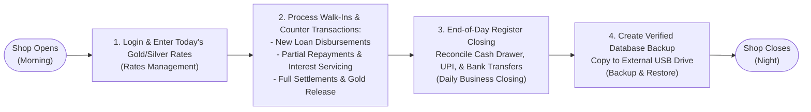

# Operator User Manual & Workflow Guide — SwarnaRaksha Loan Manager

**Document Version:** 1.0.0  
**Target Audience:** Shop Owners, Counter Cashiers, Appraisal Executives, Vault Keepers  
**Application Title:** SwarnaRaksha — Jewellery Loan Vault Desktop Application  
**Operational Environment:** 100% Offline Desktop  

---

## 1. Introduction & Operational Environment

SwarnaRaksha is an offline jewellery loan management desktop software designed specifically for Indian gold loan operators, jewellery retailers, and pawn moneylenders. It manages the entire lifecycle of collateralized gold and silver loans—from customer registration and bullion appraisal to disbursement, dynamic interest calculation, prioritized repayment allocation, and vault collateral release.

### Daily Operating Cycle Overview

---

## 2. Step-by-Step Operator Instructions

### Workflow 1: First-Run Setup & Owner Account Creation
When launching the application for the first time on a fresh computer, the **Setup Wizard** appears automatically:

1. **Firm Details:** Enter your registered Shop Name, Tagline, Street Address, City, State, PIN Code, Phone, and Email.
2. **Regulatory Identifiers:** Optionally enter your GSTIN and State Money Lending / Pawn Broker License Registration Number.
3. **Master Owner Account:** Enter your primary Administrator Username and a strong Master Password.
4. **Loan Default Settings:** Configure default monthly interest rate (e.g. `2.0%`), default LTV ceiling (e.g. `75%`), minimum interest lock days (e.g. `15 days`), and grace period days (e.g. `7 days`).
5. Click **Initialize Vault Security**. The database creates the first owner, seeds initial metal purities, and redirects to the login screen.

---

### Workflow 2: Updating Daily Gold & Silver Bullion Rates
Before booking loans for the day, update your shop's current appraisal rates:

1. From the sidebar, click **Rate Management** (TrendingUp icon).
2. The screen displays the latest active rates for Gold (`24K`, `22K`, `20K`, `18K`, `16K`, `14K`) and Silver (`999`, `925`, `900`, `800`, `700`, `600`).
3. Click **Update Rate** next to any purity (or click **Bulk Update Rates**).
4. Enter the new rate in Rupees per gram (e.g. `₹7,150.00/g`).
5. Click **Save Rate**. The new rate takes effect immediately for all subsequent loan appraisals, while existing active loans retain their historical booking rates.

---

### Workflow 3: Registering a New Customer
1. Navigate to **Customers** from the sidebar, then click **Register New Customer** (or press the topbar Quick Action **New Customer**).
2. Complete the required customer profile fields:
   - **Full Legal Name:** As stated on government ID (e.g. `Rahul Suresh Sharma`).
   - **10-Digit Mobile Number:** Mandatory primary contact.
   - **Secondary / Alternate Phone:** Optional family or emergency contact.
   - **12-Digit Aadhaar Number:** Enter the 12-digit number. The system will immediately encrypt it using AES-256-GCM. The screen will display only `XXXX XXXX 1234`.
   - **Residential Address, City, State, and PIN Code:** Mandatory for legal notice compliance.
   - **KYC & Reputation Remarks:** Optional notes on borrower reliability.
3. Click **Save Customer**. A sequential ID is generated (e.g. `CUST-000042`).

---

### Workflow 4: Booking a New Loan (Guided 10-Step Wizard)
Navigate to **New Loan** (Wizard icon) in the sidebar:

#### Step 1: Customer Identification
- Select an existing customer from the searchable dropdown (search by name, phone, or customer ID).
- Alternatively, click **+ Quick New Customer** to register a walk-in borrower without leaving the wizard.

#### Step 2: Contract Dates & Backdating Controls
- **Loan Date:** Defaults to today.
- **Backdated Loans:** If entering an existing paper contract, select the actual historical disbursement date.
  - If the date is in the past, an orange alert appears requiring a **Mandatory Backdate Justification** (e.g. *"Migrating physical pledge voucher #4512 from ledger notebook"*).
  - Backdating requires Owner authority or the `CREATE_BACKDATED_LOAN` permission.
- **Tenure:** Select loan tenure (default 6 months). The **Maturity Due Date** updates automatically.

#### Step 3: Pledging Collateral Articles
For each jewellery item pledged:
1. Select the **Article Category** (`Ring`, `Chain`, `Necklace`, `Bangles`, `Earrings`, `Anklet`, `Pendant`, `Coin`, or `Other Article`).
   - If `Other Article` is selected, enter the custom category (e.g. `Waist Chain`, `Brooch`, `Armlet`). The system automatically saves it for future autocomplete.
2. Enter a **Detailed Description** (e.g. *"22K solid yellow gold rope chain with S-hook, 916 BIS hallmark stamped"*).
3. Select **Material** (`GOLD` or `SILVER`) and **Material Type / Purity** (e.g. `22K Gold (91.67%)`).
4. Enter **Gross Scale Weight** (in grams, up to 3 decimals, e.g. `32.500 g`).
5. Enter **Stone / Tare Weight** (in grams, e.g. `0.500 g`).
6. The system instantly computes **Net Weight** (`32.000 g`), applies today's market rate per gram, and calculates the **Appraised Market Valuation** (e.g. `32.000 g * ₹7,000/g = ₹2,24,000.00`).
7. Click **+ Add Item** to add additional ornaments to the same loan.

#### Step 4: Loan Terms, LTV Assessment, & Disbursement
1. Review the **Collateral Summary Card**: Total Net Weight, Total Valuation, and Maximum Allowable Loan at 75% LTV.
2. Enter the **Requested Loan Principal** (e.g. `₹1,50,000.00`).
3. **LTV Enforcement & Override:**
   - If the requested amount is within limits, the indicator displays green (**Eligible**).
   - If the requested loan exceeds maximum LTV capacity, the indicator turns red (**LTV Ceiling Exceeded**).
   - If the borrower is a trusted client and the Owner wishes to grant an exception, check **Authorize LTV Override**, enter a mandatory reason, and confirm Owner credentials.
4. Select **Disbursement Channel** (`CASH`, `UPI`, `BANK_TRANSFER`, `CHEQUE`) and optional transaction reference (UTR/cheque number).
5. Enter optional upfront **Processing Fee** or documentation charges.
6. Click **Confirm & Disburse Loan**.
7. The system commits the loan, creates the double-entry disbursement ledger record, and opens the **Pawn Ticket / Pledge Voucher** print preview.

---

### Workflow 5: High-Speed Bulk Loan Entry (Backlog Data Entry)
When migrating a large binder of historical paper loans into SwarnaRaksha:

1. Click **Bulk Loan Entry** (TableProperties icon) in the sidebar.
2. Select the customer and the historical **Loan Date**.
3. Use the keyboard-optimized tabular data grid:
   - Row 1: Select `GOLD`, `22K Gold`, enter aggregate gross and stone weights, rate, and allocated loan amount.
   - Row 2: Select `SILVER`, `Silver 925`, enter silver vessels/articles weight and rate.
4. The system aggregates both rows into a single multi-commodity loan contract.
5. Enter the historical backdate justification reason and click **Book Loan**.

---

### Workflow 6: Counter Walk-In Appraisal (Valuation Calculator)
When a prospective borrower brings ornaments for a quick valuation without booking a loan:

1. Click **Valuation Calculator** in the sidebar.
2. Enter the gross weight, stone tare weight, precious metal type, and purity.
3. The appraisal card instantly displays:
   - Net Pure Precious Metal Weight (g)
   - Current Bullion Market Valuation (INR)
   - Maximum Loan Amount at Shop LTV Ceiling (e.g. 75%)
   - Safety Margin Held by Shop (INR)
4. No database records are written; this tool operates as an instant calculator.

---

### Workflow 7: Recording Repayments (Waterfall Engine)
When a borrower arrives to service interest or pay down principal:

1. Click **Repayments** in the sidebar, or click **Record Repayment** on any Loan Details page.
2. Select the loan number.
3. The modal displays:
   - Current Outstanding Principal
   - Accrued Unpaid Interest (dynamically calculated up to today)
   - Total Dues to Settle Today
4. Enter the **Payment Amount Received** in Rupees.
5. As you type, the **Live Waterfall Allocation Preview** shows exactly how the money will be applied:
   - **Tier 1 (Interest):** Accrued interest is settled first.
   - **Tier 2 (Fees):** Any pending fees are covered.
   - **Tier 3 (Principal):** Remaining funds reduce principal debt.
6. Select **Payment Channel** (`CASH`, `UPI`, `BANK_TRANSFER`, `CHEQUE`) and reference number.
7. Click **Confirm & Record Repayment**.
8. The system updates the ledger, advances the loan interest start date, and opens the printable **3-Part Payment Receipt** (Customer Copy, Shop Copy, Vault Copy).

---

### Workflow 8: Full Settlement, Loan Closure, & Collateral Release
When the customer pays the entire remaining balance:

1. In the **Record Repayment** modal, click the quick action **Pay Full Settlement Amount**.
2. The payment amount automatically populates with the exact total of `Principal + Accrued Interest`.
3. Confirm payment receipt.
4. The system:
   - Updates the loan status to **CLOSED**.
   - Changes the custody status of all pledged jewellery items to **RELEASED**.
   - Writes a `CLOSURE` transaction to the double-entry ledger.
   - Launches the printable **Collateral Release Certificate** showing acknowledgment signatures for the return of gold articles in good order.

---

### Workflow 9: Reversing Erroneous Ledger Postings
If a cashier makes a clerical error (e.g. entering ₹50,000 instead of ₹5,000):

1. Navigate to the loan's **Loan Details Command Center** and switch to the **Financial Ledger** tab.
2. Locate the incorrect transaction and click **Reverse Transaction** (RotateCcw icon).
3. The Reversal Modal opens:
   - Only the **Owner** has permission to execute reversals.
   - Enter an explicit, detailed justification in the **Reversal Reason** box.
4. Click **Confirm Reversal**.
5. The original transaction is marked `is_reversal = 1`, and an offsetting reversal transaction is written to the ledger. Historical records are never deleted.

---

### Workflow 10: End-of-Day Business Closing (EOD Tally)
At the end of daily trading:

1. Click **Daily Business Closing** (CalendarCheck icon) in the sidebar.
2. The register tallies the day's financial activity:
   - Total Capital Disbursed
   - Total Repayments Collected
   - Breakdown by channel: Cash Drawer, UPI, Bank Transfer, Cheque
   - Count of Loans Opened and Loans Closed
   - Net Cash Flow (`Total Collected - Total Disbursed`)
3. Physically reconcile cash in the shop drawer against the **Cash Collected** figure.
4. Click **Commit Daily Closing**.
5. Click **Print Daily Summary** to print an A4 register closing voucher for store binders.

---

### Workflow 11: Document Printing & Receipt Customization
SwarnaRaksha generates 5 official document types via the built-in **PrintModal**:

1. **Pawn Ticket / Pledge Memorandum:** Contract voucher issued at loan disbursement detailing customer, collateral specifications, interest rates, and legal pawn terms.
2. **3-Part Payment Receipt:** A4 sheet divided into 3 perforated sections: Customer Copy, Shop Accounts Copy, and Vault Copy.
3. **Collateral Release Certificate:** Formal discharge voucher confirming debt clearance and physical handover of jewellery articles.
4. **Customer Statement of Accounts:** Complete financial statement for a borrower detailing active loans, historical loans, payments, and collateral held.
5. **Daily Register Closing Summary:** End-of-day managerial reconciliation.

#### Customizing Printed Content
In the Print Modal, click **Customize Receipt Content** (Sliders icon) to toggle specific sections on or off:
- Business logo, tagline, shop telephone
- Customer residential address or Aadhaar number
- Collateral gross/stone weights, individual rate per gram, or appraised values
- Terms and conditions, authorized signature lines

All customization preferences are preserved in local browser storage (`localStorage`).

---

### Workflow 12: Creating & Restoring Backups
To protect against hard drive failure, theft, or fire:

#### Creating a Backup:
1. Navigate to **Backup & Restore** (HardDrive icon) in the sidebar.
2. Click **Create Backup Now**.
3. To save onto an external USB drive, click **Choose Destination Folder**, select your USB flash drive, and click **Create Backup**.
4. The system validates database integrity via `PRAGMA integrity_check`, safely captures all active WAL transactions, writes a timestamped archive (`jewellery_backup_manual_YYYY-MM-DD...sqlite`), and records the metadata.

#### Restoring from a Backup:
1. Under **Restore Database**, click **Select Backup File (.sqlite)**.
2. Enter the **Master Owner Password** to authorize restoration.
3. The system:
   - Performs a read-only integrity check on the backup file.
   - Creates an automatic **PRE_RESTORE** safety checkpoint of the current live database.
   - Unlinks stale journal files (`-wal`, `-shm`) and restores the database.
